# Customer Segmentation Studio — Technical Architecture

> **Source of Truth:** All decisions herein are derived from [context.md](file:///c:/Projects/Segment%20studio/context.md), which in turn is derived from the [project outline](file:///c:/Projects/Segment%20studio/segmentation_studio_outline%20(2).md). If any conflict exists between this document and context.md, context.md governs.

> [!NOTE]
> **UI Design Gate has been lifted.** The frontend dashboard has been implemented by serving the signed-off PM wireframes from `Segmentation Studio Wireframes.html` at the root path of the FastAPI application.

---
## Table of Contents

1. [System Topology](#1-system-topology)
2. [Data Ingestion & Routing](#2-data-ingestion--routing-ard-1)
3. [Layer 0 — Data Preparation Foundation](#3-layer-0--data-preparation-foundation)
4. [Layer 1 — Demographic Segmentation](#4-layer-1--demographic-segmentation)
5. [Layer 2 — Behavioral Clustering Pipeline](#5-layer-2--behavioral-clustering-pipeline)
6. [Layer 3 — Statistical Testing Layer](#6-layer-3--statistical-testing-layer)
7. [Layer 4 — Predictive Segmentation](#7-layer-4--predictive-segmentation)
8. [Layer 5 — Segment Migration Forecasting](#8-layer-5--segment-migration-forecasting)
9. [Layer 6 — Segment vs. Outcome Analysis](#9-layer-6--segment-vs-outcome-analysis)
10. [Layer 7 — Metric Integration Layer](#10-layer-7--metric-integration-layer)
11. [Layer 8 — Feature-Level Migration Signal](#11-layer-8--feature-level-migration-signal)
12. [AI Agent Architecture](#12-ai-agent-architecture)
12b. [Fallback Mode](#12b-fallback-mode)
12c. [Create Custom Segments](#12c-create-custom-segments)
13. [Database Schema Design](#13-database-schema-design)
14. [Cross-Layer Dependency Map](#14-cross-layer-dependency-map)
15. [Notification Center Architecture](#15-notification-center-architecture)
16. [LLM Integration Constraints](#16-llm-integration-constraints)
17. [Scheduling & Cadence Model](#17-scheduling--cadence-model)
18. [Explicitly Rejected Approaches](#18-explicitly-rejected-approaches)
19. [Open Items](#19-open-items)

---

## 1. System Topology

The system is a sequential + parallel pipeline of 9 numbered layers (0–8). Layers 0, 1, and 2 are upstream foundations. Layers 3–8 are downstream consumers that cannot execute without stable output from their dependencies.

### End-to-End Data Flow

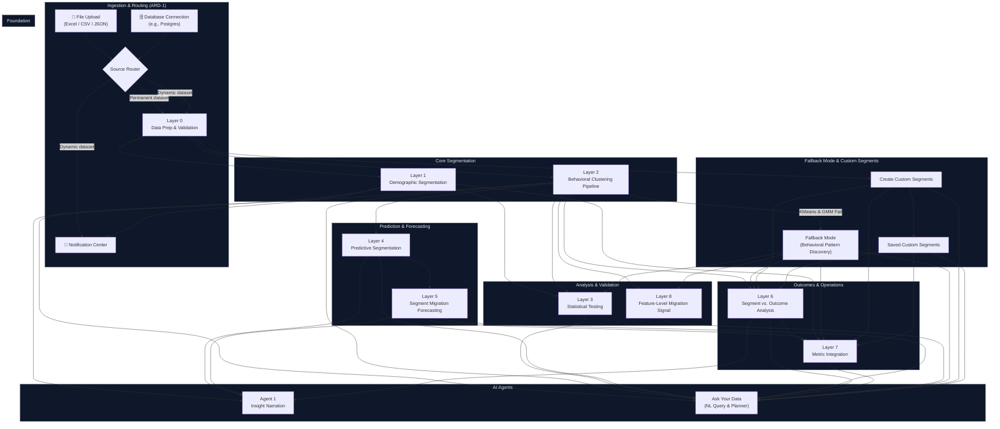

### Layer Execution Prerequisites

| Layer | Can Execute After | Hard Blockers |
| :--- | :--- | :--- |
| **Layer 0** | Dataset ingested via router | PM has not confirmed column include/exclude |
| **Layer 1** | Layer 0 complete | None — runs on static demographics |
| **Layer 2** | Layer 0 complete | None — runs on behavioral features |
| **Layer 3** | Layers 1 & 2 complete | Layer 6 outcome variables must be available |
| **Layer 4** | Layer 2.4 baseline established (at least one quarter) | No stable cluster identity → target is undefined |
| **Layer 5** | Layer 4 has produced at least one period of migration labels | Insufficient migration history |
| **Layer 6** | Layer 2 clusters exist | Cluster IDs must be stable |
| **Layer 7** | Layers 1, 5, 6 complete | No data to surface |
| **Layer 8** | Layer 2 clusters exist (medians computed) | No cluster medians → no comparison baseline |
| **Fallback Mode** | Activates after Layer 2 clustering evaluation when both KMeans and GMM confirm poor cluster structure | Both KMeans and GMM do not confirm poor cluster structure |
| **Ask Your Data** | Available after any layer has produced output | None |
| **Create Custom Segments** | Available after Layer 0 complete | None |

---

## 2. Data Ingestion & Routing (ARD-1)

### Source Classification & Behavior

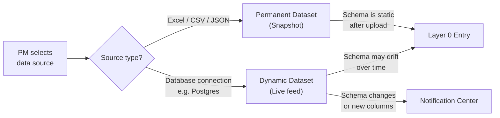

### Routing Rules

| Property | Permanent (File Upload) | Dynamic (DB Connection) |
| :--- | :--- | :--- |
| **Schema drift monitoring** | ❌ Disabled | ✅ Active |
| **Notification Center feeding** | ❌ Not applicable | ✅ Feeds on new/unsure columns |
| **Re-ingestion on new data** | ❌ Manual re-upload only | ✅ Automatic on connection |
| **Layer 1 Notification Center** | ❌ Skipped | ✅ Triggered on "Unsure" / new columns |
| **Imputation method log re-applied** | Manual trigger | Automatic re-surface if missing_pct changes |

> [!IMPORTANT]
> The source type — not a separate PM flag — is what determines dataset permanence. No additional configuration knob exists for this.

---

## 3. Layer 0 — Data Preparation Foundation

Layer 0 is a strict sequential gate. **No downstream layer may receive data that has not passed through all Layer 0 steps in order.**

### Processing Order (Non-Negotiable)

```
Profiling → Cleaning → Validation → Feature Engineering
```

### Step 3.1 — Column Confirmation

- PM reviews a table of all detected columns.
- Each column defaults to `include`.
- PM toggles any column to `exclude`.
- Excluded columns are permanently dropped at this step — they do not appear in profiling, cleaning, validation, or feature engineering.

### Step 3.2 — Profiling

**Function:** `data_profile(df_analysis)` — returns a per-column profile table.

**Output columns produced:**

| Field | Description |
| :--- | :--- |
| `missing_count` | Absolute count of NaN / null values |
| `missing_pct` | `missing_count / total_rows * 100`, rounded to 2dp |
| `dtype` | Pandas dtype string |
| `suspect_numeric_object` | `True` if dtype is `object` and >90% of non-null values parse as numeric |
| `unique_count` | `nunique(dropna=True)` |
| `non_unique_count` | `len(df) - unique_count` *(not the same as total duplicates — see caveat)* |
| `non_unique_pct` | `non_unique_count / len(df) * 100` |
| `is_unique_key` | `True` if `unique_count == len(df)` |
| `has_duplicates` | `True` if `unique_count < len(df)` |
| `severity` | Binned on `missing_pct`: `None` / `Low` / `Moderate` / `High` / `Critical` |

**Severity bins:**

| Bin | missing_pct range | Label |
| :--- | :--- | :--- |
| 0 | 0% | None |
| 1 | 0% < x ≤ 25% | Low |
| 2 | 25% < x ≤ 50% | Moderate |
| 3 | 50% < x ≤ 75% | High |
| 4 | 75% < x ≤ 100% | Critical |

> [!NOTE]
> `non_unique_count` = total row count minus distinct value count. This is **not** the number of fully duplicated rows, nor the count of values that appear more than once. Documentation (or field rename) is an open decision.

### Step 3.3 — Cleaning

#### Type Recovery (Before Final Profile)
1. Identify columns where `suspect_numeric_object = True`.
2. Apply `pd.to_numeric(col, errors='coerce')` — converts non-numeric strings to `NaN`.
3. Re-run `data_profile()` to get accurate `missing_count`/`missing_pct` before validation.

#### Negative Value Flagging
- Every numeric column containing **any** negative value is flagged — unconditionally.
- No per-column exception logic. The accepted tradeoff: occasional false positives on columns where negatives are legitimate (e.g., temperature deltas, profit/loss).

#### Duplicate Row Detection
- 100% exact full-row match only.
- Detected duplicates are surfaced to PM with row counts.
- Fuzzy/near-duplicate matching is explicitly out of scope (O(n²) cost, does not scale).

### Step 3.4 — Outlier Detection & Treatment

#### Decision Tree

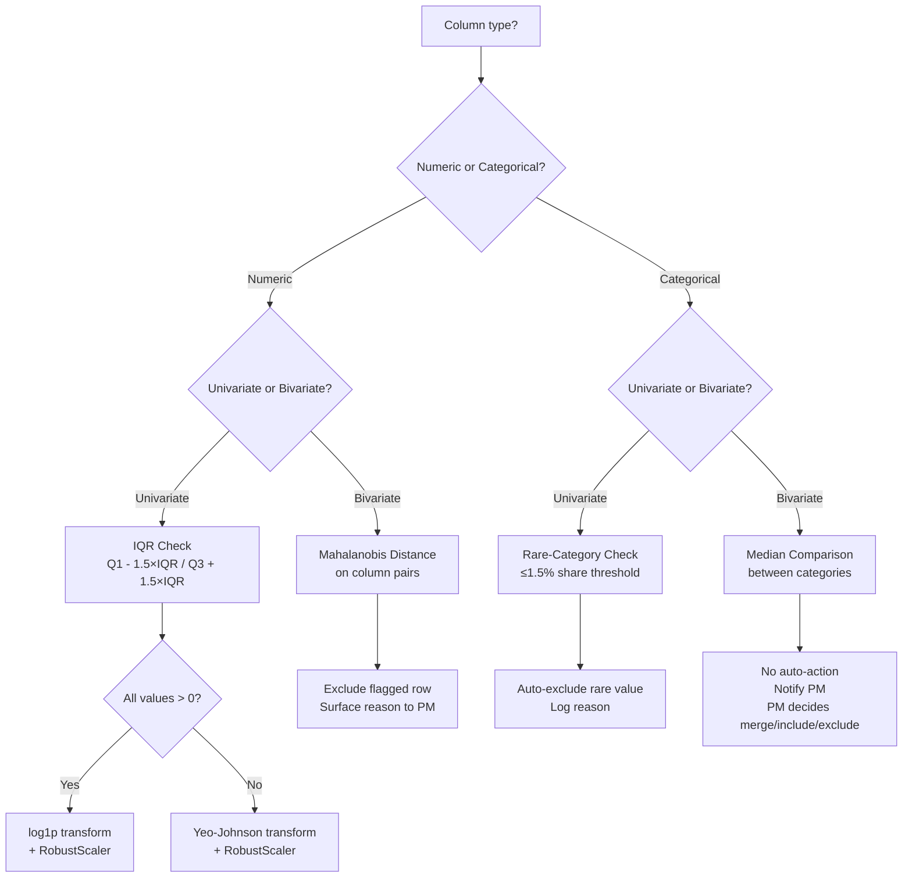

#### Outlier Treatment Summary

| Type | Detection Method | Treatment | PM Action Required? |
| :--- | :--- | :--- | :--- |
| Univariate Numeric | IQR | Column-level transform (log1p or Yeo-Johnson + RobustScaler) | No — automated |
| Univariate Categorical | Rare Categories: Values falling at or below the minimum share threshold of ≤1.5% of total rows. | Automatically excluded from analysis with the reason logged and surfaced to the PM | No — automated |
| Bivariate Numeric | Mahalanobis distance | Exclude flagged row; surface reason | No — automated (PM-approved threshold: d > 3.0) |
| Bivariate Categorical | Median category similarity | Surface candidates; no auto-action | Yes — PM decides (PM-approved threshold: <= 5% / 0.05 diff) |

### Step 3.5 — Missing Value Policy

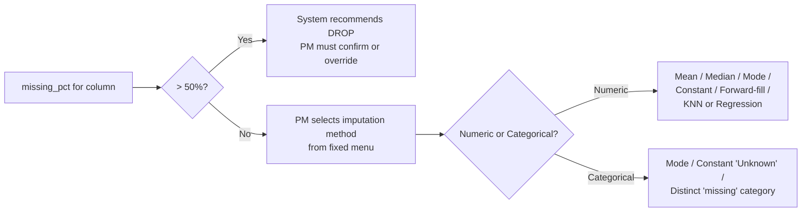

- Threshold is fixed at **50%** — not PM-adjustable.
- PM's method choice is logged per column per dataset.
- For dynamic datasets: if a later re-profile shows `missing_pct` has changed materially, the logged choice is re-surfaced automatically.

### Step 3.6 — Cross-Field Relationship Validation

**Why automated:** manually specifying every plausible cross-field invariant (e.g., `end_date >= start_date`, `total_charges ≈ monthly_charges × tenure`) is not scalable.

**Pipeline:**

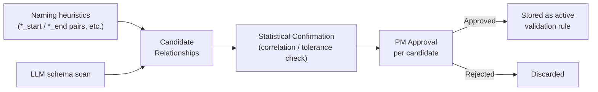

- LLM surfaces candidates, does not enforce.
- Statistical confirmation ensures the proposed rule actually holds in the data before presenting to PM.
- Only PM-approved rules become active, logged constraints.

### Step 3.7 — Feature Engineering

#### Redundant Feature Pruning
- Compute pairwise Pearson correlation matrix across all numeric columns.
- Drop one column from any pair with `|r| > 0.9`.
- Default threshold: **0.9** (adjustable).
- **Why not VIF:** VIF targets multicollinearity in regression models. KMeans is distance-based — VIF adds no relevant information here.
- **Why not ANOVA/Chi-Square:** both require a target/label variable. No label exists at this unsupervised stage.

#### Categorical Encoding Rule

| Unique values in column | Encoding method |
| :--- | :--- |
| ≤ 4 | One-hot encoding |
| > 4 | Frequency encoding (replace with count or proportion) |

**Why not target encoding:** no target variable exists at this stage.
**Why not unconditional one-hot:** would cause dimensionality explosion on high-cardinality columns, and UMAP (which would absorb it) has been dropped from Layer 2.

---

## 4. Layer 1 — Demographic Segmentation

### Architecture

```mermaid
flowchart LR
    L0_Output["Layer 0\nCleaned Dataset"] --> LLM["LLM Field Classifier\n(prompted / few-shot)"]
    LLM --> Classification["Column Classification\nDemographic / Behavioral / Unsure"]
    Classification --> PivotUI["PM Pivot-Table UI\nField Assignment Review"]
    PivotUI --> Segments["Demographic Segment\nDefinitions (Rule-Based)"]
    Segments --> MoM["Month-over-Month\nChange Tracking"]
    MoM --> Flagging["Volatility-Aware\nAnomaly Flagging"]

    Classification -->|"Unsure columns\n(Dynamic datasets only)"| NC["🔔 Notification Center"]
    NC -->|"PM resolves\nclassification"| PivotUI
```

### Field Classification & PM Confirmation

- LLM proposes: `Demographic` | `Behavioral` | `Unsure`
- PM's interaction with the **Pivot-table UI is the review step** — there is no separate approval screen.
- Field selection in the pivot table directly controls what is analyzed.

### Notification Center Integration (Dynamic Datasets Only)

Triggers when:
1. A column is classified as **"Unsure"** by the LLM.
2. A **new column** appears in the schema after the initial classification run.

Action required: PM must resolve the classification before the field enters the downstream pipeline. Permanent (file-upload) datasets bypass this entirely.

### Volatility-Aware Flagging Logic

- System learns each segment's own historical month-to-month variance.
- Anomaly threshold = segment's own historical noise band, not a fixed global percentage.
- **Why:** a fixed threshold produces false alarms on small/volatile segments and misses real shifts in large/stable segments.

### What Layer 1 Tracks

- Segment size over time (growth / decline)
- Month-over-month percentage changes per segment
- Flagged volatility anomalies

---

## 5. Layer 2 — Behavioral Clustering Pipeline

This is the most structurally critical layer. All downstream segment identity (Layers 3, 4, 5, 6, 7, 8) depends on the stable cluster definitions Layer 2 produces and maintains.

### Sub-layer Pipeline

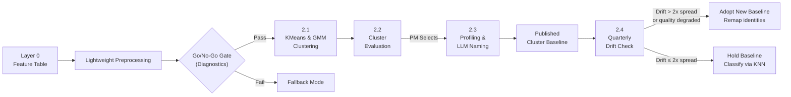

### 2.0 — Preprocessing (Lightweight Preprocessing Path)

Unlike Layer 0's full pipeline, the clustering path uses a separate lightweight preprocessing path to preserve density and metric properties:
- **Starting Point**: Aggregated customer-level data post-Layer 0 imputation.
- **Scaling**: `StandardScaler` only (specifically NOT `RobustScaler`, as compressing variance too aggressively destroys density structures needed for clustering).
- **Categorical Columns**: Frequency or one-hot encoding on categoricals per confirmed Layer 0 rules.
- **Dimensionality Reduction**: PCA via elbow method (targeting 75-85% cumulative variance) to deterministically resolve the curse of dimensionality.
- **Excluded Treatments**: No power transforms (log1p or Yeo-Johnson) in this path. These are Layer 0 data quality tools only, not clustering preprocessing.

### Go/No-Go Gate: Clustering Diagnostics

Before running any clustering algorithms, the data must pass the clustering diagnostics gate:
- **Hopkins Statistic**: target >0.75 to confirm clustering tendency.
- **Visual Assessment of Cluster Tendency (VAT) Plot**: target is visible diagonal blocks.
- **Evaluation metrics for diagnostic validation**:
  - Silhouette Score across K-means and Agglomerative at K=3, 4, 5, 6.
  - Calinski-Harabasz Index at K=3, 4, 5, 6.
- **Gate Outcome**: If Hopkins <0.75 and the VAT plot shows no blocks, the pipeline is blocked and **Fallback Mode** is evaluated.

### 2.1 — Dual-Algorithm Clustering (KMeans & GMM)

Layer 2.1 runs two distinct clustering algorithms concurrently:
- **KMeans**:
  - Configurations: K = 3, 4, 5, 6
  - Hyperparameters: fixed `random_state=42`
- **Gaussian Mixture Model (GMM)**:
  - Configurations: n_components = 3, 4, 5, 6
  - Hyperparameters: fixed `random_state=42`

- **Why GMM & KMeans**: GMM handles clusters with ellipsoidal shapes and probabilistic assignments, while KMeans partitions based on rigid Euclidean distance to centroids.

### 2.2 — Cluster Evaluation & PM Selection

- Both algorithms and all parameter counts are evaluated using:
  - **Silhouette Score** (measuring separation and cohesion)
  - **Davies-Bouldin Index** (measuring cluster overlap)
- **Reporting**: Results for both KMeans and GMM across all configured cluster/component sizes are reported in two separate dashboard tables.
- **Decision Gate**: There is no automated algorithm or K selection. The PM must review the tables, compare the evaluation metrics, and explicitly select the winning algorithm and the optimal value of K / n_components.

### 2.3 — Profiling & LLM-Assisted Naming

1. Compute mean value of every behavioral variable per cluster (e.g., mean AOV = $42.30 for cluster 3).
2. LLM reads the per-cluster average table and outputs a plain-language summary (e.g., "high return rate, low AOV, frequent logins, low discount sensitivity").
3. **PM reads the summary and assigns the final cluster name.**

> [!IMPORTANT]
> The LLM summarizes — it does not name. The PM names. This is a hard architectural principle governing all LLM use in this system.

### 2.4 — Quarterly Stability & Drift (Adopt-vs-Hold)

#### Drift Metric: Medoid Shift

- **Medoid** = the actual data point most central to the cluster (always a real member of the cluster).
- **Why medoid, not centroid:** Although KMeans is built on centroids (mean coordinates), the drift evaluator utilizes the medoid (an actual customer data point) for evaluation to remain representative and consistent with the historical data tracking requirements.
- **Significance threshold:** a medoid shift counts as meaningful only if it exceeds **2× the cluster's own historical intra-cluster spread**. This is self-calibrating — large sparse clusters require larger absolute shifts to trigger adoption.

#### Adopt-vs-Hold Decision Logic

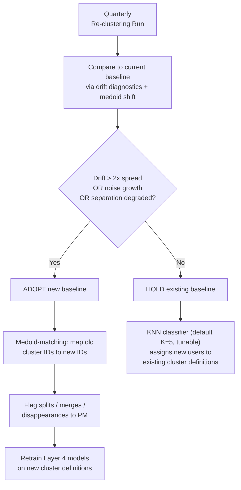

> [!IMPORTANT]
> If a new cluster baseline is adopted, **Layer 4 models must be retrained** against the new definitions. Layer 4 inherits whichever baseline is currently active.

---

## 6. Layer 3 — Statistical Testing Layer

### Purpose

Answers: "Are these segment differences statistically real, or could they be noise?"

### Implementation Stack

| Test | Library | Use Case |
| :--- | :--- | :--- |
| One-way ANOVA | `statsmodels` | Numeric outcome across 3+ groups, parametric |
| Kruskal-Wallis | `statsmodels` | Numeric outcome across 3+ groups, non-parametric |
| Chi-Square | `statsmodels` | Categorical outcome across segments |
| Tukey HSD | `statsmodels` | Post-hoc pairwise comparison after ANOVA |
| Dunn's Test | `scikit-posthocs` | Post-hoc pairwise comparison after Kruskal-Wallis |

### Anti-Circularity Constraint

```
Tests MUST use Layer 6 outcome variables:
  ✅ Churn rate, Retention rate, Revenue, Repeat purchase probability

Tests MUST NOT use the clustering input features:
  ❌ AOV, Return rate, Session duration, Login frequency
```

**Why:** Clusters are built to separate on their input features. Testing them on those same features is circular — they will trivially show statistical difference regardless of whether the segmentation is actually meaningful.

### Scope

1. **Layer 1 demographic groups** — tested against outcome variables.
2. **Layer 2 accepted clusters (post-2.2 quality gate)** — tested against outcome variables.

### Outputs

- Statistical significance flags per segment pair (p-values, effect sizes).
- Flags for segments approaching critical similarity (may not justify separate treatment).
- Flags for sharply diverging segments (high-value differentiation signal).

---

## 7. Layer 4 — Predictive Segmentation

### Purpose

Forward-looking, individual-level prediction: "What cluster will this specific customer be in at T+1?"

### Architecture

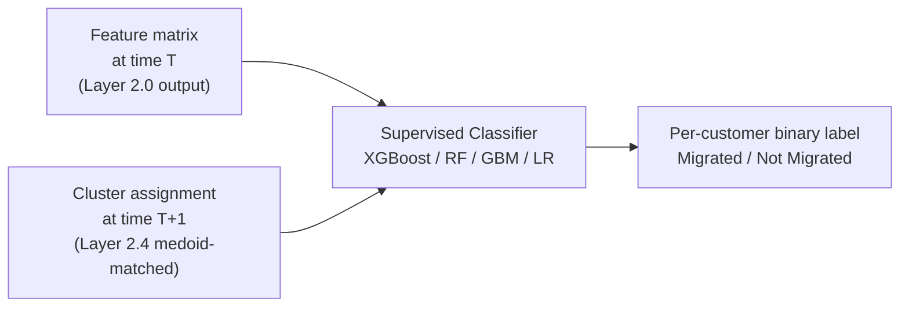

### Target Definition

A customer is labeled **Migrated** if:
```
cluster_label(T) ≠ cluster_label(T+1)
```
...where both labels are resolved through Layer 2.4's medoid-matching (not raw KMeans run outputs). This ensures the target is stable across time — it only flips if the matched cluster identity genuinely changes.

> [!IMPORTANT]
> Layer 4 output is a **binary label** (migrated / not migrated). Supervised classifiers may produce internal probability scores, but the confirmed output definition is binary.

### Candidate Models

| Model | Notes |
| :--- | :--- |
| XGBoost | Primary candidate; handles tabular data well; natively handles imbalanced classes |
| Random Forest | Strong baseline; robust to outliers |
| Gradient Boosting | Similar to XGBoost; useful for comparison |
| Logistic Regression | Simplest; useful as interpretability baseline |

### Leakage Guardrail

```
Features: strictly from time window < T
Target:   strictly from time window ≥ T+1
```

No feature computed after T may enter the model. No target observation from before T+1 may be used.

### Dependency on Layer 2.4

- If a quarterly drift evaluation results in a **new cluster baseline being adopted**, all Layer 4 models trained against the old baseline must be **retrained**.
- Layer 4 is not exempt from the adopt/hold cycle.

---

## 8. Layer 5 — Segment Migration Forecasting

### Purpose

Population-level, not individual-level. Answers: "What fraction of Cluster A's population typically moves to Cluster B each quarter?"

### Architecture

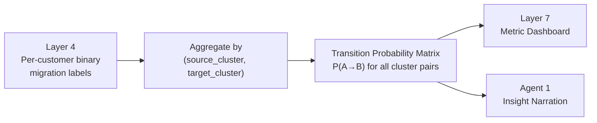

### Transition Matrix

For each cluster pair `(A, B)`:

```
P(A → B) = count(customers in A at T who are in B at T+1)
           ─────────────────────────────────────────────
                  count(customers in A at T)
```

This is computed entirely from Layer 4's per-customer binary labels — no separate migration logic is defined here.

**Empty/Disappeared Source Cluster Handling (Option B)**:
If a cluster has zero assigned customers in period $T$, it is entirely absent from the transition matrix database table (`transition_matrix`) and JSON API output for that period range. Downstream systems (e.g. dashboard APIs or Agent narration inputs) can rely on the absence of a cluster's row as a deterministic signal that the cluster's occupancy was zero in period $T$.

### Markovian Assumption

The plain transition matrix assumes only current cluster membership matters (no path history, no duration-in-state). This is a known simplification.

**Future enhancements (out of scope unless the simple matrix proves insufficient):**
- **Survival transition modeling** — captures how long a customer has been in a state before migrating.
- **Sequence modeling** — captures migration path history (e.g., Loyalist → Browser → At-risk is treated differently from Loyalist → At-risk directly).

These are contingency approaches, not planned work.

---

## 9. Layer 6 — Segment vs. Outcome Analysis

### Purpose

Bridges the segmentation system to business value. Answers: "Which segments actually matter commercially?"

### Outcome Variables Tracked

| Metric | Type | Notes |
| :--- | :--- | :--- |
| Churn rate | Rate (%) | By segment, by time period |
| Retention rate | Rate (%) | By segment, by time period |
| Revenue | Currency | By segment, by time period |
| Repeat purchase probability | Probability (0–1) | By segment, by time period |

> [!NOTE]
> Priority order among these outcome variables is an open item — not finalized.

### Role in the Broader System

Layer 6 outcome variables serve as **the test surface for Layer 3**. This is the critical anti-circularity mechanism: Layer 3 does not test clusters on their own input features; it tests them on Layer 6's external outcome variables.

- **Primary Path (Confirmed CSV)**: Uses true independent external outcomes (`Churned`, unscaled `Lifetime_Value`). Valid for all Layer 3 statistical testing.
- **Snapshot Fallback Path (`behavioral_snapshots`)**: Used only when external files are absent. Reconstructed `revenue` (`purchase_count × avg_order_value`) and `repeat_purchase_prob` are **demo/integration proxies** derived from clustering inputs and are strictly excluded from Layer 3 validation. Only `churn_rate` and `retention_rate` (derived from genuine temporal $T$-to-$T+1$ account presence) are eligible for Layer 3 statistical tests under this fallback. Layer 6 continues to display all four metrics descriptively on the dashboard.

---

## 10. Layer 7 — Metric Integration Layer

### Purpose

The operational terminal layer. Makes segmentation KPI-trackable and comparable over time.

### UI Component Specification

> [!CAUTION]
> UI implementation is blocked pending PM wireframe approval. The below is a specification of behavior, not a UI implementation.

**Three PM-controlled selectors:**

| Control | Options |
| :--- | :--- |
| Time granularity | Daily / Weekly / Monthly / Quarterly / Yearly |
| Metric / KPI | Selectable from Layer 6 outcome variables |
| Segments to compare | Any number of segment/cluster IDs |

**Table layout:** segment rows × time-period columns.

**Gap row rule:**
- Exactly **2** segments selected → render a gap row showing `Segment A value − Segment B value` per time period, directionally colored.
- **3+ segments** selected → no gap row. Raw value rows only.

---

## 11. Layer 8 — Feature-Level Migration Signal

### Purpose

An early-warning signal that fires **before** Layer 4 formally assigns a migration label. Operates at the individual feature column level, not the cluster level.

### Mechanics

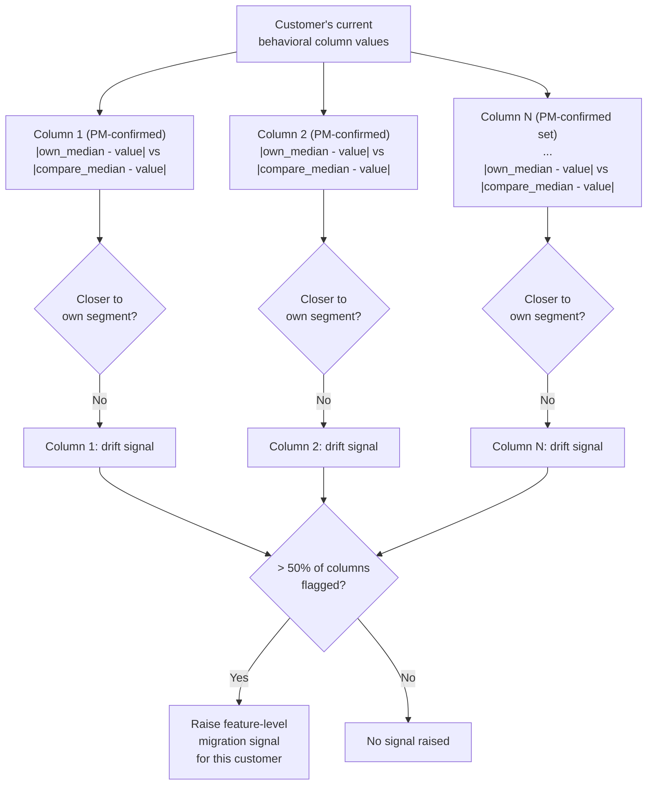

### Algorithm (Step-by-Step)

For each customer **c** currently in segment **S**, checking against comparison segment **S'**:

1. For each behavioral column `col` in the PM-confirmed set (confirmed at configuration time via the confirmation-screen UI):
   - Compute `d_own = |c[col] - median(S[col])|`
   - Compute `d_compare = |c[col] - median(S'[col])|`
   - Result: `drift[col] = True if d_compare < d_own else False`

2. Count columns where `drift[col] = True`.

3. If `count(drift == True) / total_columns > 0.50` → raise migration signal.

### Design Notes

- **Median, not mean:** specifically chosen to avoid sensitivity to outliers that have already been treated in Layer 0.
- **Not a multivariate distance:** this is a per-column absolute comparison, not a single joint-distribution distance calculation (Mahalanobis is used for outlier detection in Layer 0, not here).
- **Distinct from Layer 4:** a customer can receive a Layer 8 signal without ever being formally migrated by KMeans, and vice versa.

---

## 12. AI Agent Architecture

### Governing Principle (Non-Negotiable)

```
LLM Role: Summarize → make data legible → help humans decide faster.
LLM Non-Role: Make decisions, name things, enforce rules, generate layout.
```

Every LLM touchpoint in this system must pass this test before it is implemented.

### Agent 1 — Insight Narration Agent

**Trigger:** Quarterly, aligned with Layer 2.4 evaluation cadence.

**Input sources:**
- Layer 2.4 drift evaluation results (medoid shifts, adopt/hold outcome)
- Layer 4 migration labels (per-customer migration counts)
- Layer 5 transition matrix
- Layer 6 outcome variable deltas

**Output:** Plain-language briefing connecting cross-layer signals.

**Example narrative structure:**
> "Cluster C's medoid shifted [X units] this quarter, which exceeded its own typical spread. Layer 2.4 adopted a new baseline. 14% of the former Cluster C population was remapped to Cluster A. In the same period, Layer 6 shows churn rate for Cluster A increased from 8% to 12%. Layer 3's statistical test flags this difference as significant at p < 0.05."

#### Evaluation Guardrails

| Guardrail | Rule |
| :--- | :--- |
| **No causal claims** | Cannot use `because`, `caused by`, `due to`. Observational significance (Layer 3) establishes statistical difference or association, NEVER causation. Co-occurrences must be phrased as association (e.g., "Higher churn coincided with lower engagement", NOT "Churn increased because engagement fell"). |
| **Intensifier limits** | Words like `significantly` are permissible ONLY to describe differences validated by Layer 3 tests (e.g. "differed significantly in churn") or flagged anomalies. `dramatically` is always prohibited. |
| **No extrapolation** | Cannot make forward-looking claims beyond what Layer 4/5 output states |
| **Uncertainty flagging** | Where Layer 3 tests are inconclusive, narration must explicitly state uncertainty |
| **Traceability** | Every claim must map to an actual pipeline output field — no inference or interpolation |

---

### Ask Your Data (NL Query & Planner)

Ask Your Data is a unified natural language query and command interface for the Segmentation Studio dashboard. It replaces and absorbs the original Agent 2 functionality, extending it with intent classification, execution planning, results aggregation, and plain-language answer generation.

The pipeline runs in 7 distinct steps:

*   **Step 1 — User Input**: Accessed via a persistent search/input bar in the top bar. PM types a natural language question or command and submits.
*   **Step 2 — Intent Router**: An LLM classifies the user query into one of five intent categories:
    *   `show`: Surface a specific metric or layer output (e.g., "Show churn rate").
    *   `comparison`: Compare segments, periods, or metrics (e.g., "Compare Power Users vs Deal Seekers on retention").
    *   `root_cause`: Explain why a metric or segment profile changed (e.g., "Why did churn increase for Power Users?").
    *   `prediction`: Forward-looking questions (e.g., "Which customers are likely to migrate next quarter?").
    *   `out_of_scope`: Queries not answerable from available layer data. Returns an immediate hard stop.
*   **Step 3 — Execution Planner**: Predefined templates map each intent type to required pipeline components (no LLM call is made at this stage for performance and reliability). It outputs a JSON shopping list of `{layer, action}` steps. Full templates per intent:
    *   `show` → Single most relevant layer
    *   `comparison` → L7 (Metric Integration) + L6 (Outcome metrics)
    *   `root_cause` → L1 + L2 + L3 + L5 + L6 + L8 + A1 (executed sequentially)
    *   `prediction` → L4 + L5 + L8 (executed sequentially)
    *   `out_of_scope` → Immediate hard stop
*   **Step 4 — Execution Engine**: Dispatches each planned step to its corresponding backend API endpoint.
    *   **Dispatch Mode**: Parallel execution for `show` and `comparison`; sequential execution for `root_cause` and `prediction`.
    *   **Historical Fallback**: If the requested period's data is unavailable for a layer, it falls back to the most recent available historical data, labeling the result with a historical flag and the period details.
*   **Step 5 — Results Aggregator**: Merges all returned layer outputs into a single JSON object. No data transformation is performed, and no LLM is used.
*   **Step 6 — Answer Generator**: An LLM synthesizes a plain language answer from the aggregated JSON. The output is validated using the same `narration_evaluator.py` guardrails as Agent 1 (e.g., no hallucinated causation, strict traceability).
*   **Step 7 — Overlay Rendering**: A result overlay opens on top of the current content area (preserving active view context). It displays:
    *   Plain language answer card at the top.
    *   Supporting data panels below rendered in their natural format (tables, matrices, drift lists, etc.) labeled by source layer.
    *   Historical data warning banner (if any layer fell back to historical data).
    *   **Download PDF** and **Email Report** action buttons.

---

## 12b. Fallback Mode

Fallback Mode is a fail-safe analytical mode that activates automatically when the clustering pipeline fails to find a meaningful structure in the behavioral data.

### Trigger Conditions
The mode activates automatically (no PM decision gate required) when **BOTH** KMeans and GMM independently confirm poor cluster structure. Both must fail; if only one fails, the fallback does not activate.
Failure is defined by either:
1. Both algorithms return fewer than 3 active clusters, **OR**
2. Both algorithms return exactly 2 clusters where one contains $\ge 85\%$ of the customer population and the other contains $\le 15\%$.

### Activation & Notification
Upon trigger:
- The system automatically marks the dataset as `fallback_active = TRUE` in the database.
- A soft warning notification is emitted to the notification center, detailing:
  - The actual cluster counts and percentages that met the trigger condition.
  - The list of available vs. disabled layers.
  - A recommendation to use **Create Custom Segments**.

### Layer Availability
- **Available Layers (using L1 demographic groups as a segmentation basis)**:
  - L1, L3, L6, L7, L8, A1, Ask Your Data, Create Custom Segments
- **Disabled Layers (greyed out with "Clustering Required" label)**:
  - L2, L4, L5

### Behavioral Pattern Discovery
This is the core fallback analytical feature:
- **Algorithm**: Fixed-Width Frequent Pattern Discovery using FP-Growth (`mlxtend.frequent_patterns.fpgrowth`), with Apriori as a fallback if memory constraints are met.
- **Reference Set**: The PM manually selects a column reference set after fallback activates: 3, 5, 7, 9, 11, or custom columns.
- **Data Bucketing**:
  - Continuous numeric columns are binned into quartiles: *Bottom 25%*, *Middle 50%*, and *Top 25%*.
  - Categorical columns: each unique value is treated as a separate item.
- **Output**: Surfaced as a row-wise dashboard table showing the pattern combinations, customer count, and percentage of the total population.
- **View Options**: PM selects the display limit: Top 5, Top 10, Top 20, or a Custom count.
- **Exporting**: No PDF or email export is available for this table — it is a pure dashboard-only view.

---

## 12c. Create Custom Segments

Create Custom Segments mode allows PMs to build ad-hoc segment definitions on top of existing data, completely independent of the K-means/GMM clustering pipeline.

### Sidebar Navigation & Interface
- **Create Custom Segments**: Opens the workspace titled "Welcome to Build Custom Segments".
- **Saved Custom Segments**: Accesses all previously saved segment definitions to edit, re-run, or delete them.

### Step 1: Define Segments
- **Naming**: PM assigns a name to each segment. No limit on the number of segments.
- **Numeric Columns**: Presented as quartile-based ranges (*Bottom 25%*, *Middle 50%*, *Top 25%*) or a custom range slider.
- **Categorical Columns**: Presented as checklists of all unique values.
- **Overlaps**: PM can use a `(+)` button to define multiple segments concurrently. Overlaps are permitted; customers can belong to multiple segments.
- **Navigation**: A back button is available at all times to return and modify segment definitions.

### Step 2: Select Comparison Options
PM selects which analyses to run on the defined custom segments. Multiple options can be selected simultaneously, and the PM selects the time period and columns per option. Each option's results card features its own **Download PDF** and **Email Report** buttons:
1.  **Compare with Baseline Segments**: Compares selected custom segment columns against the existing K-means/GMM baseline clusters.
2.  **How Aggregates Changed**: Compares the custom segment's columns between period T and T+1.
3.  **Compare Custom Segments**: Side-by-side comparison across all custom segments built (visible only when 2+ custom segments exist).
4.  **L3 Statistical Testing**: Runs significance tests (ANOVA, Kruskal-Wallis, Chi-square) between custom segments (requires 2+ segments).
5.  **L6 Outcome Analysis**: Computes outcome metrics (churn, retention, revenue, repeat purchase probability) for the custom segment.
6.  **L7 Metric Integration**: Comparison table with granularity/metric/time selectors (supporting gap rows if exactly 2 segments are selected).
7.  **L8 Feature Signal**: Checks for early-warning drift of the custom segment population toward other clusters/segments using median comparison.

### Saving & Scheduling
- **Persistence**: Session-only by default. Definitions are permanently saved to the database only if explicitly saved by the PM. Closing the builder without saving triggers no warning prompts.
- **Scheduling**: Saved segments can be scheduled to run at monthly or custom intervals. Re-evaluates segment membership against the latest data and runs selected comparison options.
- **Alerts**: Surfaced in the notification center upon completion of scheduled runs.

---

---

## 13. Database Schema Design

### Infrastructure

- **Engine:** PostgreSQL
- **Hosting:** Container (Docker)
- **Time requirement:** First-class temporal key on every table involved in T vs T+1 comparisons.

### Core Schema

```sql
-- ─────────────────────────────────────────────────────────
-- Customers (static identity)
-- ─────────────────────────────────────────────────────────
CREATE TABLE customers (
    customer_id     UUID PRIMARY KEY,
    created_at      TIMESTAMPTZ NOT NULL DEFAULT now()
);

-- ─────────────────────────────────────────────────────────
-- Periods (the temporal unit for all snapshot comparisons)
-- ─────────────────────────────────────────────────────────
CREATE TABLE periods (
    period_id       SERIAL PRIMARY KEY,
    period_label    TEXT NOT NULL,          -- e.g. '2025-Q1'
    period_start    DATE NOT NULL,
    period_end      DATE NOT NULL,
    granularity     TEXT NOT NULL           -- 'quarterly' | 'monthly' | 'weekly'
);

-- ─────────────────────────────────────────────────────────
-- Behavioral Feature Snapshots (Layer 2.0 input)
-- One row per customer per period
-- ─────────────────────────────────────────────────────────
CREATE TABLE behavioral_snapshots (
    snapshot_id         UUID PRIMARY KEY DEFAULT gen_random_uuid(),
    customer_id         UUID NOT NULL REFERENCES customers(customer_id),
    period_id           INTEGER NOT NULL REFERENCES periods(period_id),
    login_frequency     NUMERIC,
    session_duration    NUMERIC,
    purchase_count      INTEGER,
    avg_order_value     NUMERIC,
    return_rate         NUMERIC,
    discount_sensitivity NUMERIC,
    email_engagement    NUMERIC,
    app_engagement      NUMERIC,
    captured_at         TIMESTAMPTZ NOT NULL DEFAULT now(),
    UNIQUE (customer_id, period_id)
);

-- ─────────────────────────────────────────────────────────
-- Cluster Baselines (Layer 2 — one baseline per version)
-- ─────────────────────────────────────────────────────────
CREATE TABLE cluster_baselines (
    baseline_id     SERIAL PRIMARY KEY,
    adopted_at      TIMESTAMPTZ NOT NULL DEFAULT now(),
    is_active       BOOLEAN NOT NULL DEFAULT true,
    adopted_reason  TEXT,                   -- 'initial' | 'drift' | 'quality_degraded'
    period_id       INTEGER REFERENCES periods(period_id)
);

-- ─────────────────────────────────────────────────────────
-- Cluster Definitions (per baseline)
-- ─────────────────────────────────────────────────────────
CREATE TABLE clusters (
    cluster_id          SERIAL PRIMARY KEY,
    baseline_id         INTEGER NOT NULL REFERENCES cluster_baselines(baseline_id),
    cluster_label       TEXT,               -- PM-assigned name (e.g. 'Loyalists')
    medoid_customer_id  UUID REFERENCES customers(customer_id),
    intra_cluster_spread NUMERIC,           -- Used for 2x drift threshold
    created_at          TIMESTAMPTZ NOT NULL DEFAULT now()
);

-- ─────────────────────────────────────────────────────────
-- Cluster Assignments (Layer 2 — T-stamped, one row per customer per period)
-- ─────────────────────────────────────────────────────────
CREATE TABLE cluster_assignments (
    assignment_id   UUID PRIMARY KEY DEFAULT gen_random_uuid(),
    customer_id     UUID NOT NULL REFERENCES customers(customer_id),
    period_id       INTEGER NOT NULL REFERENCES periods(period_id),
    cluster_id      INTEGER NOT NULL REFERENCES clusters(cluster_id),
    assigned_via    TEXT NOT NULL,          -- 'kmeans' | 'knn_classifier'
    assigned_at     TIMESTAMPTZ NOT NULL DEFAULT now(),
    UNIQUE (customer_id, period_id)
);

-- ─────────────────────────────────────────────────────────
-- Cluster Identity Mapping (Layer 2.4 — across baseline transitions)
-- ─────────────────────────────────────────────────────────
CREATE TABLE cluster_identity_map (
    map_id          SERIAL PRIMARY KEY,
    old_cluster_id  INTEGER REFERENCES clusters(cluster_id),
    new_cluster_id  INTEGER REFERENCES clusters(cluster_id),
    match_type      TEXT NOT NULL,          -- 'matched' | 'split' | 'merged' | 'disappeared' | 'new'
    created_at      TIMESTAMPTZ NOT NULL DEFAULT now()
);

-- ─────────────────────────────────────────────────────────
-- Migration Labels (Layer 4 output — binary per customer per period pair)
-- ─────────────────────────────────────────────────────────
CREATE TABLE migration_labels (
    label_id        UUID PRIMARY KEY DEFAULT gen_random_uuid(),
    customer_id     UUID NOT NULL REFERENCES customers(customer_id),
    from_period_id  INTEGER NOT NULL REFERENCES periods(period_id),
    to_period_id    INTEGER NOT NULL REFERENCES periods(period_id),
    from_cluster_id INTEGER REFERENCES clusters(cluster_id),
    to_cluster_id   INTEGER REFERENCES clusters(cluster_id),
    migrated        BOOLEAN NOT NULL,       -- TRUE = cluster label changed
    labeled_at      TIMESTAMPTZ NOT NULL DEFAULT now(),
    UNIQUE (customer_id, from_period_id, to_period_id)
);

-- ─────────────────────────────────────────────────────────
-- Transition Matrix (Layer 5 — population-level aggregation)
-- ─────────────────────────────────────────────────────────
CREATE TABLE transition_matrix (
    matrix_id           SERIAL PRIMARY KEY,
    from_period_id      INTEGER NOT NULL REFERENCES periods(period_id),
    to_period_id        INTEGER NOT NULL REFERENCES periods(period_id),
    from_cluster_id     INTEGER NOT NULL REFERENCES clusters(cluster_id),
    to_cluster_id       INTEGER NOT NULL REFERENCES clusters(cluster_id),
    customer_count      INTEGER NOT NULL,
    transition_prob     NUMERIC NOT NULL,   -- P(from → to)
    computed_at         TIMESTAMPTZ NOT NULL DEFAULT now(),
    UNIQUE (from_period_id, to_period_id, from_cluster_id, to_cluster_id)
);

-- ─────────────────────────────────────────────────────────
-- Outcome Metrics (Layer 6 — per segment per period)
-- ─────────────────────────────────────────────────────────
CREATE TABLE segment_outcomes (
    outcome_id          UUID PRIMARY KEY DEFAULT gen_random_uuid(),
    cluster_id          INTEGER NOT NULL REFERENCES clusters(cluster_id),
    period_id           INTEGER NOT NULL REFERENCES periods(period_id),
    churn_rate          NUMERIC,
    retention_rate      NUMERIC,
    revenue             NUMERIC,
    repeat_purchase_prob NUMERIC,
    computed_at         TIMESTAMPTZ NOT NULL DEFAULT now(),
    UNIQUE (cluster_id, period_id)
);

-- ─────────────────────────────────────────────────────────
-- Feature-Level Migration Signals (Layer 8)
-- ─────────────────────────────────────────────────────────
CREATE TABLE feature_migration_signals (
    signal_id               UUID PRIMARY KEY DEFAULT gen_random_uuid(),
    customer_id             UUID NOT NULL REFERENCES customers(customer_id),
    period_id               INTEGER NOT NULL REFERENCES periods(period_id),
    own_cluster_id          INTEGER REFERENCES clusters(cluster_id),
    compared_cluster_id     INTEGER REFERENCES clusters(cluster_id),
    columns_checked         INTEGER NOT NULL,
    columns_drifted         INTEGER NOT NULL,
    drift_fraction          NUMERIC NOT NULL,   -- columns_drifted / columns_checked
    signal_raised           BOOLEAN NOT NULL,   -- TRUE if drift_fraction > 0.50
    evaluated_at            TIMESTAMPTZ NOT NULL DEFAULT now()
);

-- ─────────────────────────────────────────────────────────
-- Demographic Snapshots (Layer 1)
-- ─────────────────────────────────────────────────────────
-- Redesigned as a typed columnar table based on the PM-confirmed column list.
CREATE TABLE demographic_snapshots (
    demo_snapshot_id    UUID PRIMARY KEY DEFAULT gen_random_uuid(),
    customer_id         UUID NOT NULL REFERENCES customers(customer_id),
    period_id           INTEGER NOT NULL REFERENCES periods(period_id),
    -- Typed columns represent the PM-confirmed demographic schema.
    -- (Examples of dynamic fields generated at configuration time:)
    age                 INTEGER,
    gender              TEXT,
    country             TEXT,
    -- Additional PM-confirmed demographic columns are added dynamically at configuration time
    captured_at         TIMESTAMPTZ NOT NULL DEFAULT now(),
    UNIQUE (customer_id, period_id)
);

-- ─────────────────────────────────────────────────────────
-- Custom Segments (definitions)
-- ─────────────────────────────────────────────────────────
CREATE TABLE custom_segments (
    segment_id      UUID PRIMARY KEY DEFAULT gen_random_uuid(),
    dataset_id      UUID NOT NULL REFERENCES datasets(dataset_id),
    segment_name    TEXT NOT NULL,
    conditions      JSONB NOT NULL,
    created_at      TIMESTAMPTZ NOT NULL DEFAULT now(),
    updated_at      TIMESTAMPTZ NOT NULL DEFAULT now()
);

-- ─────────────────────────────────────────────────────────
-- Custom Segment Schedules
-- ─────────────────────────────────────────────────────────
CREATE TABLE custom_segment_schedules (
    schedule_id     UUID PRIMARY KEY DEFAULT gen_random_uuid(),
    segment_id      UUID NOT NULL REFERENCES custom_segments(segment_id),
    granularity     TEXT NOT NULL,
    selected_options JSONB NOT NULL,
    last_run_at     TIMESTAMPTZ,
    next_run_at     TIMESTAMPTZ,
    created_at      TIMESTAMPTZ NOT NULL DEFAULT now()
);

-- ─────────────────────────────────────────────────────────
-- Custom Segment Run Results
-- ─────────────────────────────────────────────────────────
CREATE TABLE custom_segment_results (
    result_id       UUID PRIMARY KEY DEFAULT gen_random_uuid(),
    segment_id      UUID NOT NULL REFERENCES custom_segments(segment_id),
    run_at          TIMESTAMPTZ NOT NULL DEFAULT now(),
    option          TEXT NOT NULL,
    result_data     JSONB NOT NULL
);
```

### Time-Native Design Rationale

> [!IMPORTANT]
> Every table that feeds T vs T+1 comparisons must have a `period_id` foreign key. A current-state-only flat schema (e.g., a single `customers` row with no temporal key) would require a full redesign to support Layers 4, 5, 7, and 8. This constraint is non-negotiable and must be baked in from the first migration.

---

## 14. Cross-Layer Dependency Map

### Data Object Flow

| Data Object | Produced By | Consumed By |
| :--- | :--- | :--- |
| Cleaned feature table | Layer 0 | Layers 1, 2, Create Custom Segments |
| Demographic field classification | Layer 1 LLM | Layer 1 Pivot UI, Notification Center |
| Demographic segment performance | Layer 1 | Layers 3, 7, Fallback Mode |
| Behavioral cluster assignments (T-stamped) | Layer 2.1 + 2.2 | Layers 3, 4, 6, 8 |
| Cluster medians & medoids | Layer 2.3 + 2.4 | Layer 8 (medians), Layer 4 (medoid-matched labels) |
| Active cluster baseline | Layer 2.4 | Layers 4, 5, 6, 7 |
| Statistical significance flags | Layer 3 | Agent 1, Create Custom Segments (Option 4) |
| Binary migration labels (per customer) | Layer 4 | Layer 5 |
| Transition probability matrix | Layer 5 | Layers 7, Agent 1 |
| Outcome metrics (per segment, per period) | Layer 6 | Layers 3, 7, Agent 1, Create Custom Segments (Option 5) |
| Feature-level drift signals | Layer 8 | Agent 1, Ask Your Data, Create Custom Segments (Option 7) |
| Ask Your Data query answer | Ask Your Data | PM (consumes: all layer outputs, quarterly_narrations/Agent 1) |
| Behavioral pattern discovery results | Fallback Mode | PM dashboard (consumes: KMeans/GMM results, L1 demographic groups) |
| Custom segment definitions & results | Create Custom Segments | PM dashboard, PDF/email export (consumes: Layer 0 data, L3/L6/L7/L8) |

### Cascade Impact of a Cluster Baseline Change (Layer 2.4 Adopt)

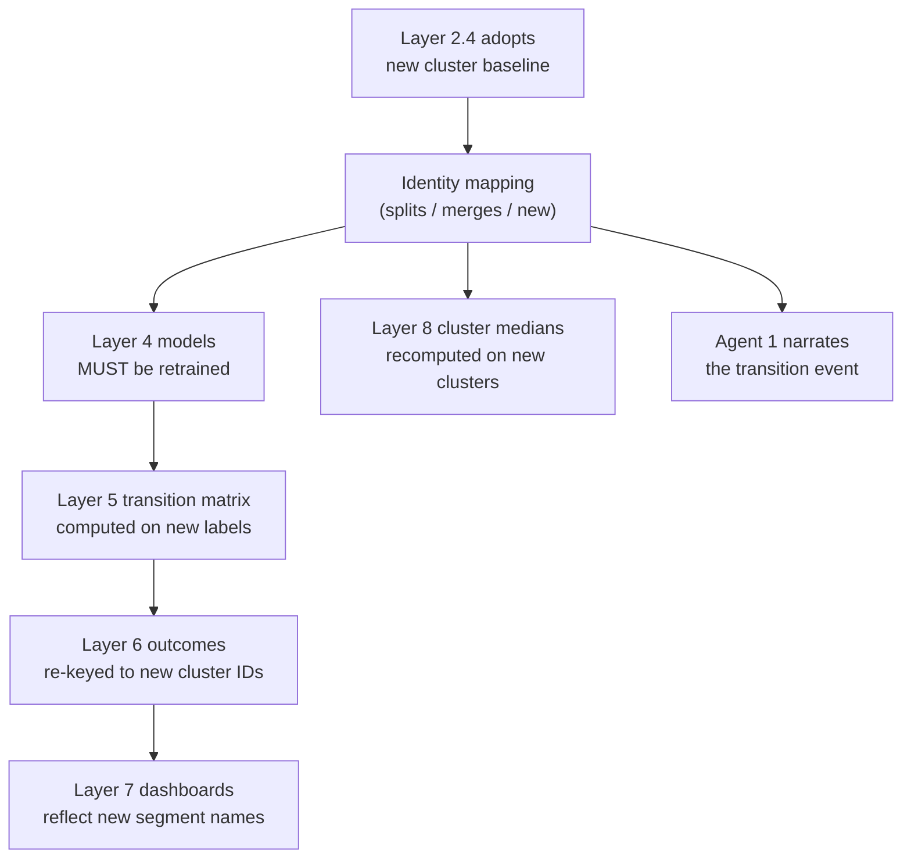

---

## 15. Notification Center Architecture

### Trigger Sources

| Source | Trigger Condition | Dataset Type |
| :--- | :--- | :--- |
| ARD-1 Router | Database connection established | Dynamic only |
| Layer 0 Validation | Hard-fail check (PK duplicate, missing expected column, referential integrity break) | Both |
| Layer 1 LLM | Column classified as "Unsure" | Dynamic only |
| Layer 1 Schema Monitor | New column detected after initial classification | Dynamic only |
| Layer 2.2 | Cluster quality gate failure | Both |
| Layer 2.4 | Cluster baseline adoption / splits / merges | Both |
| Layer 3 | Segments approaching critical similarity or critical divergence | Both |
| Fallback Mode | Both KMeans and GMM confirm poor cluster structure (triggers soft warning showing available vs disabled layers) | Both |

### Failure Action Model

| Failure Type | Action | PM Gate |
| :--- | :--- | :--- |
| **Hard fail** | Blocks pipeline progression; routes to notification center | PM must resolve before pipeline continues |
| **Soft warning** | Logged; does not block; surfaced in notification center | PM informed; no action required to proceed |

**Hard fail examples:** PK duplicates, referential integrity breaks, expected column missing, Layer 2.2 quality gate failure.

**Soft warning examples:** Outlier counts, class imbalance, drift within tolerable range, Fallback Mode activation.

---

## 16. LLM Integration Constraints

### Touchpoint Registry

| Location | LLM Input | LLM Output | PM Decision Required? |
| :--- | :--- | :--- | :--- |
| Layer 0 (Cross-field rules) | Schema column names & types | Candidate relationship list | ✅ Yes — approves/rejects each candidate |
| Layer 1 | Column names & types | `Demographic` / `Behavioral` / `Unsure` classification | ✅ Yes — overrides via Pivot UI |
| Layer 2.3 | Per-cluster average feature values | Plain-language cluster profile summary | ✅ Yes — assigns final cluster name |
| Agent 1 | All layer outputs for the quarter | Narrative briefing | ✅ Yes — decides what to act on |
| Ask Your Data Intent Router | PM's natural-language query | Intent classification (`show` / `comparison` / `root_cause` / `prediction` / `out_of_scope`) | ❌ No — automated routing, no PM decision required |
| Ask Your Data Answer Generator | Aggregated JSON output from all relevant layers | Plain-language synthesized answer card | ✅ Yes — PM reads and acts on the answer |

### Hard Rules for All LLM Use

1. **No unilateral decisions.** The LLM proposes, summarizes, or routes. The PM decides.
2. **No causal language** unless statistically supported by pipeline output.
3. **No forward extrapolation** beyond what Layer 4/5 explicitly models.
4. **No magnitude intensifiers** (`significantly`, `dramatically`) for changes within established volatility bands.
5. **Strict traceability.** Every LLM output claim must map to a specific pipeline data field.

---

## 17. Scheduling & Cadence Model

| Process | Trigger | Frequency |
| :--- | :--- | :--- |
| Layer 2.4 — Cluster drift evaluation | Scheduled | Quarterly |
| Layer 4 — Migration label generation | After each period ends | Per period (quarterly by default) |
| Layer 5 — Transition matrix recomputation | After Layer 4 labels available | Per period |
| Agent 1 — Insight Narration | After Layer 2.4 evaluation | Quarterly |
| Layer 1 — Schema drift check | Database schema change event | Continuous (dynamic datasets only) |
| Layer 6 — Outcome metric computation | After each period ends | Per period |
| Custom Segment re-evaluation | Scheduled / Batch run | Monthly or Custom |

### Quarterly Batch Order

```
1. Collect behavioral + outcome data for the period
2. Layer 0 re-profile (dynamic datasets) → re-apply imputation if needed
3. Layer 2.1 → run KMeans and GMM clustering
4. Fallback Trigger Detector → evaluate KMeans and GMM results — if fallback conditions met, activate fallback mode, skip steps 5-7
5. Layer 2.4 → evaluate drift → Adopt or Hold
6. If Adopt: retrain Layer 4 models → Layer 5 recompute
   If Hold: Layer 4 label generation with existing models → Layer 5 recompute
7. Layer 6 → compute outcome metrics for this period
8. Layer 3 → re-run statistical tests with new outcome data
9. Layer 8 → compute feature migration signals for this period
10. Agent 1 → generate quarterly narration briefing
11. If fallback active → run behavioral pattern discovery if PM has configured column sets
12. Custom Segments → run scheduled segment re-evaluation
```

---

## 18. Explicitly Rejected Approaches

These were considered during the design process and deliberately excluded. They should not be reintroduced without documented PM sign-off.

| Rejected Approach | Layer | Reason for Rejection |
| :--- | :--- | :--- |
| Manual rule-based behavioral segments (Loyalists, Browsers, etc.) | Layer 2 | Creates definitional conflicts with KMeans; data must dictate groups, not hand-drawn rules |
| UMAP dimensionality reduction | Layer 2.1 | Introduces random-seed instability that corrupts Layer 2.4 drift detection; replaced by PCA as the deterministic alternative |
| Persona enrichment layer (post-migration profiling) | (cut layer) | Redundant — Layer 2.3 already produces cluster profiling |
| VIF (Variance Inflation Factor) | Layer 0 feature engineering | Targets regression multicollinearity; inapplicable to KMeans distance-based clustering |
| ANOVA/Chi-Square for feature selection | Layer 0 feature engineering | Require a target label; no label exists at this unsupervised stage |
| Fuzzy/near-duplicate matching | Layer 0 cleaning | O(n²) pairwise comparison; does not scale; exact full-row match is sufficient |
| Manual scatterplot review for bivariate outliers | Layer 0 outlier detection | Replaced entirely by automated Mahalanobis distance detection |
| Fixed-threshold demographic anomaly flagging | Layer 1 | Causes false alarms on volatile segments and misses real shifts in stable segments |
| Centroid-based drift detection | Layer 2.4 | Centroid can fall outside irregular clusters; medoid is always a real member |
| LLM-assigned cluster names | Layer 2.3 | Violates governing LLM principle; naming is a PM decision |
| HDBSCAN (Hierarchical Density-Based Spatial Clustering with Noise) | Layer 2.1 | Requires complex hyperparameter tuning, can assign a high fraction of points to noise (-1), and does not guarantee a fixed or stable number of clusters, which complicates downstream predictive mapping and transition models. Replaced by KMeans. |
| LLM generating custom visualizations | Agent 2 | Violates governing LLM principle; routing to existing output is the only sanctioned action |
| Survival/sequence migration models (currently) | Layer 5 | Not in scope; contingency enhancement only if plain transition matrix proves insufficient |
| RobustScaler in clustering preprocessing path | Layer 2.0 (Clustering Prep) | Destroys density structure needed for clustering by compressing variance too aggressively; replaced by StandardScaler in the lightweight clustering pipeline |
| Open-ended association rule mining | Fallback Mode | Produces combinatorial explosion (100,000+ combinations); replaced by Fixed-Width Frequent Pattern Discovery with constrained column reference sets |

---

## 19. Open Items

> [!WARNING]
> The following items are unresolved and must be decided before the affected layers can be implemented.

| # | Open Item | Affects |
| :--- | :--- | :--- |
| 1 | **Layer 6 outcome metric priority** — Which variable (churn, revenue, repeat purchase probability) is analyzed first? | Layers 3, 6, 7 |
| 3 | **`non_unique_count` definition** — Rename, redefine, or document-as-is? Currently `len(df) - unique_count`, which is not the same as "number of duplicate rows" | Layer 0 profiling |
