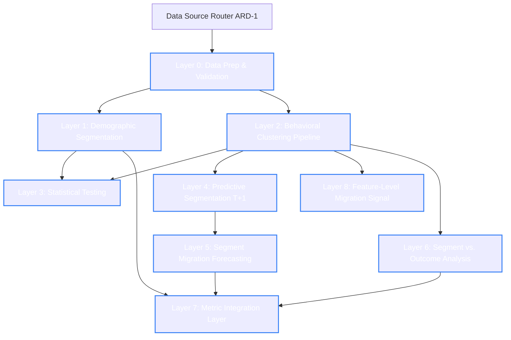

# Customer Segmentation Studio — Project Context & Specification

This document serves as the central context and system specification for the **Customer Segmentation Studio** project. It is derived from the planning notes in [segmentation_studio_outline (2).md](file:///c:/Projects/Segment%20studio/segmentation_studio_outline%20(2).md).

---

## System Architecture Overview

The framework consists of a 9-layer pipeline (Layers 0 to 8) processing raw data sources into operational KPIs, predictive insights, and AI-narrated briefings, alongside a Build Custom Segments tool for ad-hoc definition, comparison, and automated scheduling. 

### Data Flow & Dependency Diagram



### Layer Summary Table

| Layer | Component Name | Primary Purpose | Key Algorithms / Tech | Inputs / Outputs |
| :--- | :--- | :--- | :--- | :--- |
| **Layer 0** | [Data Prep & Foundation](#layer-0--data-preparation-foundation) | Raw data profiling, validation, scaling, and feature engineering. | Pandas, IQR, Mahalanobis, Yeo-Johnson / RobustScaler | **In:** Raw Excel/CSV/JSON/DB<br>**Out:** Cleaned & engineered feature table |
| **Layer 1** | [Demographic Segmentation](#layer-1--demographic-segmentation) | Rule-based grouping by static user traits. | LLM (field classification), volatility-aware noise bands | **In:** Demographic attributes<br>**Out:** Static demographic segment performance |
| **Layer 2** | [Behavioral Clustering Pipeline](#layer-2--behavioral-clustering-pipeline) | Algorithmic behavioral grouping. | KMeans, PCA, Medoid-drift tracking, KNN classifier | **In:** Behavioral features<br>**Out:** Stable behavioral cluster definitions |
| **Layer 3** | [Statistical Testing Layer](#layer-3--statistical-testing-layer) | Validate statistical divergence of segments on business outcomes. | `statsmodels` (ANOVA, Kruskal-Wallis), `scikit-posthocs` (Dunn's) | **In:** Segments & outcome metrics (Layer 6)<br>**Out:** Statistical significance flags |
| **Layer 4** | [Predictive Segmentation](#layer-4--predictive-segmentation) | Predict customer-level cluster migration at $T+1$. | XGBoost, Random Forest, Logistic / Gradient Boosting | **In:** Features at $T$, Target assignment at $T+1$<br>**Out:** Binary migration label per customer (migrated / not migrated) |
| **Layer 5** | [Segment Migration Forecasting](#layer-5--segment-migration-forecasting) | Model population-level transitions between segments. | Transition probability matrix (Markovian), survival models | **In:** Layer 4 customer migrations<br>**Out:** Flow matrix & path trajectories |
| **Layer 6** | [Segment vs. Outcome Analysis](#layer-6--segment-vs-outcome-analysis) | Relate segments to core financial/retention outcomes. | SQL / Pandas aggregations | **In:** Segment IDs & outcome metrics<br>**Out:** Segment-to-outcome mapping |
| **Layer 7** | [Metric Integration Layer](#layer-7--metric-integration-layer) | Surface comparative segment dashboards and KPIs. | React / Pivot UI, directional gap rows | **In:** Segment KPIs over time<br>**Out:** Matrix comparison dashboard |
| **Layer 8** | [Feature-Level Migration Signal](#layer-8--feature-level-migration-signal) | Early warning of behavioral drift before cluster reassignment. | Per-column absolute median comparison, >50% rollup threshold | **In:** Raw behavioral feature columns<br>**Out:** Feature-level drift warning flags |

---

## Architectural Requirement Decisions (ARD)

### ARD-1 — Data Source Entry & Permanence
The selection of data source dynamically controls the system's schema permanence and notification routing:
* **File Upload (Excel/CSV/JSON):** Treated as a **permanent dataset** (snapshot). The schema is static. The flow proceeds directly to the dashboard after Layer 0's initial configuration.
* **Database Connection (e.g., Postgres):** Treated as a **dynamic dataset** (live feed). Schema drift checks feed into the Notification Center.

---

## Layer-by-Layer Architecture & Logic

### Layer 0 — Data Preparation Foundation

Layer 0 acts as a strict gateway. Upstream processing cannot proceed until data has completed validation, cleaning, and profiling.

#### 1. Column Selection & Confirmation
The Product Manager (PM) is presented with all detected columns to toggle `include` / `exclude` (default: include). Excluded columns are immediately dropped and bypass profiling/cleaning.

#### 2. Profiling Implementation
The profiling step utilizes the [data_profile](file:///c:/Projects/Segment%20studio/segmentation_studio_outline%20(2).md#L44-L76) function:
```python
import pandas as pd

def data_profile(df_analysis):
    return (
        df_analysis.isna()
        .sum()
        .to_frame("missing_count")
        .assign(
            missing_pct=lambda x: ((x["missing_count"] / len(df_analysis)) * 100).round(2),
            dtype=df_analysis.dtypes.astype(str),
            suspect_numeric_object=lambda x: (
                df_analysis.dtypes.astype(str).eq("object")
                & df_analysis.apply(
                    lambda col: (
                        pd.to_numeric(col.dropna(), errors="coerce").notna().mean() > 0.9
                        if col.dropna().shape[0] > 0
                        else False
                    )
                )
            ),
            unique_count=df_analysis.nunique(dropna=True),
            non_unique_count=lambda x: len(df_analysis) - x["unique_count"],
            non_unique_pct=lambda x: ((x["non_unique_count"] / len(df_analysis)) * 100).round(2),
            is_unique_key=lambda x: x["unique_count"] == len(df_analysis),
            has_duplicates=lambda x: x["unique_count"] < len(df_analysis),
            severity=lambda x: pd.cut(
                x["missing_pct"],
                bins=[-0.01, 0, 25, 50, 75, 100],
                labels=["None", "Low", "Moderate", "High", "Critical"],
                include_lowest=True
            )
        )
        .sort_values("missing_pct", ascending=False)
    )
```

> [!NOTE]
> **Caveat on Uniqueness Metrics:** `non_unique_count` tracks the total count of excess occurrences beyond each value's first appearance, not the absolute number of duplicate rows.

#### 3. Cleaning & Coercion Rules
* **Type Recovery:** Columns flagged as `suspect_numeric_object` (object columns where >90% of values are numeric) are coerced using `pd.to_numeric(col, errors='coerce')` before profiling is finalized.
* **Negative Value Flagging:** Unconditional flagging of all negative numbers in numeric columns to flag errors (e.g., negative age, negative BMI).
* **Duplicate Rows:** Exact full-row duplicate matches are filtered (fuzzy matching is explicitly excluded).

#### 4. Outlier Detection & Treatment
Four types of outliers are evaluated:
1. **Univariate Numeric (IQR):** Boundary check outside `Q1 - 1.5*IQR` / `Q3 + 1.5*IQR`.
   * *Treatment:* Column-level transform. Strictly positive columns receive a `log1p` transform + `RobustScaler`. Columns crossing into negative bounds receive a `Yeo-Johnson` transform + `RobustScaler`.
2. **Univariate Categorical:** Flag categories at or below the minimum share threshold of ≤1.5% of total count (rare-category detection).
   * *Treatment:* Automatically excluded from analysis with the reason logged and surfaced to the PM.
3. **Bivariate Numeric (Mahalanobis Distance):** Automated distance check identifying points diverging from the joint distribution (PM-approved threshold: d > 3.0).
   * *Treatment:* Flagged rows are excluded from analysis; reasons are shown to the PM.
4. **Bivariate Categorical (Median Category Similarity):** Candidates with close median distributions are flagged (PM-approved threshold: <= 5% / 0.05 difference).
   * *Treatment:* Action is manual; PM decides whether to merge values.

#### 5. Missing Value Policies
* **Missing % > 50%:** System generates a "drop column" recommendation (requires PM confirmation).
* **Missing % <= 50%:** Requires PM to assign an imputation strategy:
  * *Numeric:* Mean, Median, Mode, Constant, Forward-fill, or Model-based (KNN/Regression).
  * *Categorical:* Mode, Constant ("Unknown"), or a distinct "missing" category indicator.

#### 6. Cross-Field Relationship Validation
Instead of manual constraint writing, cross-field logical rules (e.g., `end_date >= start_date`) are determined via a 3-step automated pipeline:
1. **Candidate Proposal:** Schema scanning via naming heuristics and LLM logic suggests potential invariants.
2. **Statistical Confirmation:** Candidates are validated against historical data distributions.
3. **PM Approval:** Only approved rules are activated and stored in the configuration log.

#### 7. Feature Engineering Constraints
* **Pruning:** Drop one of any pairwise correlation pairs exceeding a threshold of $0.9$.
* **Encoding:** Categorical fields with $\le 4$ classes are One-Hot Encoded. Fields with $> 4$ classes are Frequency Encoded.

---

### Layer 1 — Demographic Segmentation

* **Concept:** Non-algorithmic, rules-based segment groupings (Age, Gender, Location).
* **Classification Pipeline:** An LLM proposes initial classification (Demographic vs. Behavioral vs. Unsure). The PM interacts with a Pivot-table UI to adjust assignments.
* **Flagging Logic:** Employs **volatility-aware flagging** rather than static threshold flags. The system calculates historical noise bands per segment and triggers anomalies only if drift exceeds standard variances.
* **Notification Center (Dynamic Datasets Only):** For database-connected datasets, any column the LLM classifies as "Unsure," or any new column that appears after the initial classification run, must surface as a **"PM attention required"** item in the notification center. The PM resolves the field's classification from there before the field is allowed to enter the downstream pipeline. Permanent (file-upload) datasets skip this path — schema does not change after the initial ingestion.

---

### Layer 2 — Behavioral Clustering Pipeline

Behavioral clustering defines the core segment model dynamically using machine learning. Manual rule-based definitions have been deprecated.


* **2.0 Preprocessing:** Generates a purely numeric, cleaned user feature matrix (login frequency, session duration, purchases, AOV, return rate, etc.).
* **2.1 Clustering:** PCA dimensionality reduction followed by KMeans clustering on the PCA-reduced feature matrix. (UMAP dimension reduction was dropped due to random seed instability, and PCA was chosen as the deterministic alternative to resolve the curse of dimensionality).
* **2.2 Cluster Evaluation:** Prior to publishing, clusters must pass quality gates:
  * *Stability:* Resiliency of cluster boundaries during sub-sampling.
  * *Separation:* Evaluated via Silhouette Score and Davies-Bouldin Index.
  * *Noise Sanity:* Validates that noise fraction is 0.0 (always passes under KMeans).
* **2.3 Profiling & Naming:** Cluster average feature values are compiled. An LLM reads the averages to write a human-legible profile summary. The PM reviews the summary to define the final segment name.
* **2.4 Quarterly Stability & Drift (Adopt-vs-Hold):**
  * *Cadence:* Evaluated quarterly.
  * *Metric:* **Medoid shift** (using actual central data points, not centroid means). Drift is significant only if it exceeds **2x** the cluster's historical intra-cluster spread.
  * *Adopt:* If drift is $> 2x$ or cluster quality degrades $\rightarrow$ establish a new baseline; map old identities to new ones, flagging splits or merges.
  * *Hold:* If the quarterly re-cluster result is **not meaningfully different** → **hold** the existing baseline; discard this run's result; continue classifying new users into the existing stable cluster definitions (via a lightweight classifier — e.g., KNN with default K=5, tunable parameter — trained on the current baseline, rather than re-deriving clusters from scratch on every use).

---

### Layer 3 — Statistical Testing Layer

* **Objective:** Prevent false insights by statistically validating differences.
* **Implementation:** Built using Python `statsmodels` (ANOVA, Kruskal-Wallis, Chi-square, Tukey HSD) and `scikit-posthocs` (Dunn's test).
* **Circularity Fix:** Tests are evaluated on **Layer 6's outcome variables** (e.g., churn, revenue, ARPU), never on the raw input behavioral variables used to generate the clusters.

---

### Layer 4 — Predictive Segmentation

* **Objective:** Predict individual customer segment transitions for time period $T+1$.
* **Model Pipeline:** Trained supervised classifiers (XGBoost, Random Forest, Gradient Boosting, or Logistic Regression) map features at $T$ to the target assignment at $T+1$.
* **Migration Target:** A customer is flagged as migrated if their matched cluster label (determined by Layer 2.4 medoid tracking) changes between $T$ and $T+1$.
* **Leakage Guardrail:** Features are strictly bound to time window $< T$, and targets to window $\ge T+1$.

---

### Layer 5 — Segment Migration Forecasting

* **Objective:** Model population-level flows between clusters (e.g., "15% of Browsers migrate to Loyalists").
* **Implementation:** A transition probability matrix aggregates the customer-level outputs from Layer 4. 
* **Enhancements:** Two more sophisticated methods — **survival transition modeling** (captures time-in-state duration) and **sequence modeling** (captures path history) — are retained as potential future enhancements only if the simple transition matrix proves insufficient. They are not in scope and should not be treated as planned work.

---

### Layer 6 — Segment vs. Outcome Analysis

* **Objective:** Link segments directly to commercial outcomes: Churn rate, Retention rate, Revenue, and Repeat purchase probability.

---

### Layer 7 — Metric Integration Layer

* **Objective:** Integrate segment performance into standard reporting dashboards.
* **UI Controls:** Time granularity selector, metric/KPI selector, and segment comparison lists.
* **Granularity UI Rule:** A directional gap row (Segment A value $-$ Segment B value) is displayed only when **exactly two** segments are chosen for comparison.

---

### Layer 8 — Feature-Level Migration Signal

* **Objective:** Provide a secondary, early-warning signal for individual users before an official cluster reassignment occurs.
* **Mechanics:**
  1. For each behavioral column individually from the PM-confirmed set (confirmed at configuration time via the configuration-screen UI), compute the customer's absolute distance to their own segment's **column median** and their absolute distance to the compared segment's **column median**.
  2. This produces a **per-column binary result:** is this customer closer to their own segment's median, or closer to the compared segment's median for this column?
  3. **Rollup Rule:** If **>50%** of the behavioral columns in the PM-confirmed set are closer to the compared segment's median, a feature-level migration signal is raised for that customer.

> [!NOTE]
> This is a per-column median comparison rolled up via a 50% threshold — not a single multivariate feature-space distance calculation. Median is used specifically (not mean) to avoid sensitivity to outliers already handled elsewhere in the pipeline.

---

## LLM Governing Principles & Agent Capabilities

### The Governing Principle
> [!IMPORTANT]
> The role of any LLM in the system is to make data **legible** (translating numeric vectors, metadata, or queries into text). The LLM is strictly prohibited from making **decisions** (naming segments, approving database schemas, or routing queries to custom visuals). The human PM is the final decision-maker.

### Agent 1 — Insight Narration Agent
Triggers quarterly on the Layer 2.4 evaluation cadence. It synthesizes cross-layer trends (e.g., correlating medoid shifts with financial outcomes).

* **Traceability Constraint:** Every assertion must map directly to raw pipeline output.
* **Evaluation Guardrails:**
  * *No Hallucinated Causation:* Forbidden from using causal terms (`because`, `caused by`, `due to`) unless statistically validated.
  * *No Extrapolation:* Predictions are limited strictly to Layer 4/5 outputs.
  * *No Invented Magnitudes:* Prohibited from using intensifiers (`significantly`, `dramatically`) for movements within normal volatility bands.

### Agent 2 — Natural Language Query Agent
A search bar within the dashboard converting natural language into filters on existing reports.

* **Pre-populated Examples:** Pre-loaded queries teach PMs acceptable request boundaries.
* **Hard Scope Constraints:** Queries must be **Segment-bound** and **Time-bound**. Queries outside these boundaries return a hard stop.
* **No Custom Rendering:** Returns existing dashboards filtered to the criteria; it does not generate custom components.

---

## Infrastructure & Data Model

* **Engine:** PostgreSQL instance hosted in a container.
* **Time-Native Constraint:** The database schema must support snapshotting over time rather than flat tables. Every table processing comparative metrics must store a temporal key (timestamp/period ID) to accommodate $T$ vs $T+1$ predictive and migration modeling.

---

## STRICT GATE — UI Design Phase

> [!CAUTION]
> **Antigravity must not generate UI code, design React components, or construct mock layouts until the PM has completed and signed off on UI mockups and wireframes for all layers and agent capabilities.**
>
> Antigravity is required to remind the PM of this block at the beginning of each session.

---

## Traceability Log (Explicitly Cut Features)

For audit purposes, the following features from the initial draft were rejected:
1. **Manual Rule-Based Behavioral Segments:** Cut to prevent structural conflicts with KMeans clustering.
2. **Persona Enrichment Layer (Post-migration profiling):** Removed as redundant since Layer 2.3 already provides detailed profiling.
3. **UMAP Dimensionality Reduction:** Cut to eliminate random-seed instability issues during drift tracking.
4. **VIF / ANOVA / Chi-Square (Feature Engineering):** correlation checks alone ($>0.9$) were deemed sufficient; VIF is redundant since clustering is not a regression model.
5. **Fuzzy Duplicate Matching:** Dropped due to scaling limitations; 100% exact match is the active rule.
6. **Manual Scatterplot Reviews:** Replaced entirely by automated Mahalanobis distance outlier detection.

---

## Open Items & Uncertainties

1. **Outcome Metric Priority:** The initial order of priority for outcomes in Layer 6 (churn, revenue, or repeat purchase probability) is not finalized.
2. **Exploratory Datasets:** The target data source and sandbox schema for early iteration are not yet selected.
