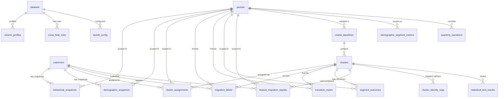

# Customer Segmentation Studio — Database Schema Reference

> **Source of truth:** [architecture.md §13](file:///c:/Projects/Segment%20studio/architecture.md) · [implementation_plan.md](file:///c:/Projects/Segment%20studio/implementation_plan.md)
> 
> **Engine:** PostgreSQL (Docker container)
> **Time-Native Constraint:** Every table involved in T vs T+1 comparisons carries a `period_id` foreign key referencing `periods`. This constraint is non-negotiable.

---

## Table Index

| # | Table | Owner Layer | Description |
| :--- | :--- | :--- | :--- |
| 1 | [`customers`](#1-customers) | Identity | Static customer identity registry |
| 2 | [`periods`](#2-periods) | Temporal | Time period definitions (quarterly / monthly / weekly) |
| 3 | [`datasets`](#3-datasets) | ARD-1 Ingestion | Ingestion source metadata and permanence flag |
| 4 | [`column_profiles`](#4-column_profiles) | Layer 0 | Per-column profiling output from `data_profile()` |
| 5 | [`cross_field_rules`](#5-cross_field_rules) | Layer 0 | PM-approved cross-field validation rules |
| 6 | [`notifications`](#6-notifications) | All layers | Central notification center event log |
| 7 | [`behavioral_snapshots`](#7-behavioral_snapshots) | Layer 2.0 | Behavioral feature values per customer per period |
| 8 | [`demographic_snapshots`](#8-demographic_snapshots) | Layer 1 | Typed demographic attributes per customer per period |
| 9 | [`cluster_baselines`](#9-cluster_baselines) | Layer 2 | Versioned cluster baseline records |
| 10 | [`clusters`](#10-clusters) | Layer 2.3 | Individual cluster definitions within a baseline |
| 11 | [`cluster_assignments`](#11-cluster_assignments) | Layer 2.1 / 2.4 | Customer → cluster mapping per period |
| 12 | [`cluster_identity_map`](#12-cluster_identity_map) | Layer 2.4 | Cross-baseline cluster identity tracking (splits/merges) |
| 13 | [`migration_labels`](#13-migration_labels) | Layer 4 | Binary migration label per customer per period pair |
| 14 | [`transition_matrix`](#14-transition_matrix) | Layer 5 | Population-level cluster-to-cluster transition probabilities |
| 15 | [`segment_outcomes`](#15-segment_outcomes) | Layer 6 | Five outcome metrics per cluster per period |
| 16 | [`feature_migration_signals`](#16-feature_migration_signals) | Layer 8 | Per-column drift signals per customer per period |
| 17 | [`statistical_test_results`](#17-statistical_test_results) | Layer 3 | Statistical test outputs per segment pair |
| 18 | [`quarterly_narrations`](#18-quarterly_narrations) | Agent 1 | LLM-generated quarterly insight narrations |
| 19 | [`layer8_config`](#19-layer8_config) | Layer 8 | PM-confirmed column set for Layer 8 signal computation |
| 20 | [`demographic_segment_metrics`](#20-demographic_segment_metrics) | Layer 1 | Month-over-month segment size and change metrics |
| 21 | [`custom_segments`](#21-custom_segments) | Custom Segments | Custom segment definitions and conditions |
| 22 | [`custom_segment_schedules`](#22-custom_segment_schedules) | Custom Segments | Scheduling information for custom segments |
| 23 | [`custom_segment_results`](#23-custom_segment_results) | Custom Segments | Historical run results for custom segment schedules |

---

## Entity-Relationship Overview



---

## Table Details

### 1. `customers`

**Purpose:** Static identity anchor. All other tables reference this via `customer_id`. Contains no behavioral or demographic data — those are in snapshot tables.

```sql
CREATE TABLE customers (
    customer_id     UUID PRIMARY KEY,
    created_at      TIMESTAMPTZ NOT NULL DEFAULT now()
);
```

| Column | Type | Nullable | Notes |
| :--- | :--- | :--- | :--- |
| `customer_id` | UUID | NOT NULL | PK — externally assigned (from source dataset) |
| `created_at` | TIMESTAMPTZ | NOT NULL | Row creation timestamp |

**Indexes:** PK on `customer_id`.

---

### 2. `periods`

**Purpose:** The universal temporal unit. Every table that holds T vs T+1 data references this. Period definitions are created at ingestion time and must be stable — changing a period's `period_start`/`period_end` after downstream data has been written is a schema integrity risk.

```sql
CREATE TABLE periods (
    period_id       SERIAL PRIMARY KEY,
    period_label    TEXT NOT NULL,
    period_start    DATE NOT NULL,
    period_end      DATE NOT NULL,
    granularity     TEXT NOT NULL
);
```

| Column | Type | Nullable | Allowed Values / Notes |
| :--- | :--- | :--- | :--- |
| `period_id` | SERIAL | NOT NULL | PK — auto-incremented |
| `period_label` | TEXT | NOT NULL | Human-readable, e.g. `'2025-Q1'`, `'2025-01'` |
| `period_start` | DATE | NOT NULL | Inclusive start of the period |
| `period_end` | DATE | NOT NULL | Inclusive end of the period |
| `granularity` | TEXT | NOT NULL | `'quarterly'` \| `'monthly'` \| `'weekly'` |

**Constraints:** No two periods with the same `period_label` should overlap (application-level enforcement).

---

### 3. `datasets`

**Purpose:** Tracks every ingested data source — its type, permanence flag, and ingestion timestamp. Added by Phase 1 (ARD-1 router). Dynamic datasets register with schema drift monitoring upon insertion.

```sql
CREATE TABLE datasets (
    dataset_id          UUID PRIMARY KEY DEFAULT gen_random_uuid(),
    source_type         TEXT NOT NULL,
    permanence          TEXT NOT NULL,
    ingested_at         TIMESTAMPTZ NOT NULL DEFAULT now(),
    connection_string   TEXT,
    file_name           TEXT,
    confirmed_columns   JSONB
);
```

| Column | Type | Nullable | Notes |
| :--- | :--- | :--- | :--- |
| `dataset_id` | UUID | NOT NULL | PK |
| `source_type` | TEXT | NOT NULL | `'file_upload'` \| `'database_connection'` |
| `permanence` | TEXT | NOT NULL | `'permanent'` \| `'dynamic'` — derived from `source_type` |
| `ingested_at` | TIMESTAMPTZ | NOT NULL | When the source was first registered |
| `connection_string` | TEXT | NULL | Populated for dynamic datasets only |
| `file_name` | TEXT | NULL | Populated for file upload datasets only |
| `confirmed_columns` | JSONB | NULL | PM's include/exclude decision per column: `[{column, include: bool}]` |

---

### 4. `column_profiles`

**Purpose:** Persists the output of `data_profile()` for each column per dataset. Created in Phase 1 (Layer 0 profiler). Serves as the input to cleaning, outlier detection, and imputation steps.

```sql
CREATE TABLE column_profiles (
    profile_id          UUID PRIMARY KEY DEFAULT gen_random_uuid(),
    dataset_id          UUID NOT NULL REFERENCES datasets(dataset_id),
    column_name         TEXT NOT NULL,
    missing_count       INTEGER,
    missing_pct         NUMERIC,
    dtype               TEXT,
    suspect_numeric_object BOOLEAN,
    unique_count        INTEGER,
    non_unique_count    INTEGER,
    non_unique_pct      NUMERIC,
    is_unique_key       BOOLEAN,
    has_duplicates      BOOLEAN,
    severity            TEXT,
    imputation_method   TEXT,
    profiled_at         TIMESTAMPTZ NOT NULL DEFAULT now(),
    UNIQUE (dataset_id, column_name)
);
```

| Column | Type | Nullable | Notes |
| :--- | :--- | :--- | :--- |
| `profile_id` | UUID | NOT NULL | PK |
| `dataset_id` | UUID | NOT NULL | FK → `datasets.dataset_id` |
| `column_name` | TEXT | NOT NULL | Column being profiled |
| `missing_count` | INTEGER | NULL | Absolute count of NaN/null values |
| `missing_pct` | NUMERIC | NULL | `missing_count / total_rows * 100` (2dp) |
| `dtype` | TEXT | NULL | Pandas dtype string, e.g. `'float64'`, `'object'` |
| `suspect_numeric_object` | BOOLEAN | NULL | `True` if dtype is `object` but >90% values are numeric |
| `unique_count` | INTEGER | NULL | `nunique(dropna=True)` |
| `non_unique_count` | INTEGER | NULL | `len(df) - unique_count` *(not duplicate row count — see [context.md §Layer 0](file:///c:/Projects/Segment%20studio/context.md))* |
| `non_unique_pct` | NUMERIC | NULL | `non_unique_count / len(df) * 100` |
| `is_unique_key` | BOOLEAN | NULL | `True` if `unique_count == len(df)` |
| `has_duplicates` | BOOLEAN | NULL | `True` if `unique_count < len(df)` |
| `severity` | TEXT | NULL | `'None'` \| `'Low'` \| `'Moderate'` \| `'High'` \| `'Critical'` |
| `imputation_method` | TEXT | NULL | PM's chosen method — logged after the PM selects it |
| `profiled_at` | TIMESTAMPTZ | NOT NULL | When the profile was computed |

**Severity bins:**

| Bin | `missing_pct` range | Label |
| :--- | :--- | :--- |
| 0 | 0% | None |
| 1 | 0% < x ≤ 25% | Low |
| 2 | 25% < x ≤ 50% | Moderate |
| 3 | 50% < x ≤ 75% | High |
| 4 | 75% < x ≤ 100% | Critical |

---

### 5. `cross_field_rules`

**Purpose:** Stores PM-approved cross-field validation rules (e.g., `end_date >= start_date`). Rules proposed by LLM or naming heuristics are stored with `approved = false` until explicitly approved by the PM.

```sql
CREATE TABLE cross_field_rules (
    rule_id         UUID PRIMARY KEY DEFAULT gen_random_uuid(),
    dataset_id      UUID NOT NULL REFERENCES datasets(dataset_id),
    rule_description TEXT NOT NULL,
    rule_expression TEXT NOT NULL,
    proposed_by     TEXT NOT NULL,
    approved        BOOLEAN NOT NULL DEFAULT false,
    created_at      TIMESTAMPTZ NOT NULL DEFAULT now(),
    approved_at     TIMESTAMPTZ
);
```

| Column | Type | Nullable | Notes |
| :--- | :--- | :--- | :--- |
| `rule_id` | UUID | NOT NULL | PK |
| `dataset_id` | UUID | NOT NULL | FK → `datasets.dataset_id` |
| `rule_description` | TEXT | NOT NULL | Human-readable rule description |
| `rule_expression` | TEXT | NOT NULL | Machine-evaluable expression (e.g., `end_date >= start_date`) |
| `proposed_by` | TEXT | NOT NULL | `'llm'` \| `'heuristic'` |
| `approved` | BOOLEAN | NOT NULL | `false` until PM approves via API |
| `created_at` | TIMESTAMPTZ | NOT NULL | Proposal timestamp |
| `approved_at` | TIMESTAMPTZ | NULL | Set when PM approves |

---

### 6. `notifications`

**Purpose:** Central event log for the notification center. Every pipeline hard-fail and soft-warning is emitted here. Hard-fails block pipeline progression until PM resolves. Soft-warnings are informational only.

```sql
CREATE TABLE notifications (
    notification_id UUID PRIMARY KEY DEFAULT gen_random_uuid(),
    source          TEXT NOT NULL,
    condition       TEXT NOT NULL,
    severity        TEXT NOT NULL,
    dataset_type    TEXT,
    details         TEXT,
    resolved        BOOLEAN NOT NULL DEFAULT false,
    emitted_at      TIMESTAMPTZ NOT NULL DEFAULT now(),
    resolved_at     TIMESTAMPTZ
);
```

| Column | Type | Nullable | Notes |
| :--- | :--- | :--- | :--- |
| `notification_id` | UUID | NOT NULL | PK |
| `source` | TEXT | NOT NULL | Layer or component that emitted the event, e.g. `'layer0'`, `'layer2.2'` |
| `condition` | TEXT | NOT NULL | Short condition identifier, e.g. `'negative_value_flagged'`, `'quality_gate_failure'` |
| `severity` | TEXT | NOT NULL | `'hard_fail'` \| `'soft_warning'` |
| `dataset_type` | TEXT | NULL | `'file_upload'` \| `'database_connection'` |
| `details` | TEXT | NULL | Full human-readable explanation with column names, values, and thresholds |
| `resolved` | BOOLEAN | NOT NULL | `true` after PM resolves a hard-fail |
| `emitted_at` | TIMESTAMPTZ | NOT NULL | When the event was raised |
| `resolved_at` | TIMESTAMPTZ | NULL | When PM resolved it |

**Note:** `hard_fail` rows must have `resolved = true` before the pipeline can proceed past the blocking step.

---

### 7. `behavioral_snapshots`

**Purpose:** Stores the behavioral feature values for each customer at each time period. This is the primary input for Layer 2.0 (KMeans preprocessing) and Layer 8 (median comparison). One row per customer per period.

```sql
CREATE TABLE behavioral_snapshots (
    snapshot_id          UUID PRIMARY KEY DEFAULT gen_random_uuid(),
    customer_id          UUID NOT NULL REFERENCES customers(customer_id),
    period_id            INTEGER NOT NULL REFERENCES periods(period_id),
    login_frequency      NUMERIC,
    session_duration     NUMERIC,
    purchase_count       INTEGER,
    avg_order_value      NUMERIC,
    return_rate          NUMERIC,
    discount_sensitivity NUMERIC,
    email_engagement     NUMERIC,
    app_engagement       NUMERIC,
    captured_at          TIMESTAMPTZ NOT NULL DEFAULT now(),
    UNIQUE (customer_id, period_id)
);
```

| Column | Type | Nullable | Notes |
| :--- | :--- | :--- | :--- |
| `snapshot_id` | UUID | NOT NULL | PK |
| `customer_id` | UUID | NOT NULL | FK → `customers.customer_id` |
| `period_id` | INTEGER | NOT NULL | FK → `periods.period_id` — **required for T vs T+1** |
| `login_frequency` | NUMERIC | NULL | Behavioral feature — login count or rate |
| `session_duration` | NUMERIC | NULL | Behavioral feature — avg session length |
| `purchase_count` | INTEGER | NULL | Behavioral feature — transaction count in period |
| `avg_order_value` | NUMERIC | NULL | Behavioral feature — AOV in period |
| `return_rate` | NUMERIC | NULL | Behavioral feature — return fraction |
| `discount_sensitivity` | NUMERIC | NULL | Behavioral feature — discount usage rate |
| `email_engagement` | NUMERIC | NULL | Behavioral feature — email open/click rate |
| `app_engagement` | NUMERIC | NULL | Behavioral feature — mobile app usage score |
| `captured_at` | TIMESTAMPTZ | NOT NULL | When the snapshot was recorded |

**Constraint:** `UNIQUE (customer_id, period_id)` — one snapshot per customer per period.

> [!NOTE]
> The behavioral columns listed above match the ecommerce development dataset. In production, PM-confirmed behavioral columns from the Layer 1 field classification determine which columns populate this table.

---

### 8. `demographic_snapshots`

**Purpose:** Stores demographic attribute values per customer per period. **Uses a typed columnar schema** — not EAV (Entity-Attribute-Value). The actual columns are determined by the PM's confirmed demographic field list from Layer 1 and are generated via `ALTER TABLE` at configuration time.

```sql
CREATE TABLE demographic_snapshots (
    demo_snapshot_id    UUID PRIMARY KEY DEFAULT gen_random_uuid(),
    customer_id         UUID NOT NULL REFERENCES customers(customer_id),
    period_id           INTEGER NOT NULL REFERENCES periods(period_id),
    -- Typed columns generated dynamically from PM-confirmed demographic field list.
    -- Examples shown below — actual columns added via ALTER TABLE at configuration time:
    age                 INTEGER,
    gender              TEXT,
    country             TEXT,
    -- (additional PM-confirmed columns added here at configuration time)
    captured_at         TIMESTAMPTZ NOT NULL DEFAULT now(),
    UNIQUE (customer_id, period_id)
);
```

| Column | Type | Nullable | Notes |
| :--- | :--- | :--- | :--- |
| `demo_snapshot_id` | UUID | NOT NULL | PK |
| `customer_id` | UUID | NOT NULL | FK → `customers.customer_id` |
| `period_id` | INTEGER | NOT NULL | FK → `periods.period_id` — **required for temporal tracking** |
| `age` | INTEGER | NULL | Example confirmed demographic column |
| `gender` | TEXT | NULL | Example confirmed demographic column |
| `country` | TEXT | NULL | Example confirmed demographic column |
| `captured_at` | TIMESTAMPTZ | NOT NULL | When the snapshot was recorded |

> [!IMPORTANT]
> This table must **never** be implemented as `field_name TEXT / field_value TEXT` rows (EAV pattern). Actual typed columns are the confirmed design. An EAV pattern would lose type enforcement and make per-column querying prohibitively complex.

---

### 9. `cluster_baselines`

**Purpose:** Tracks every version of the cluster model. Each time Layer 2.4 adopts a new clustering (due to significant drift), a new baseline record is created. Only one baseline has `is_active = true` at any time.

```sql
CREATE TABLE cluster_baselines (
    baseline_id     SERIAL PRIMARY KEY,
    adopted_at      TIMESTAMPTZ NOT NULL DEFAULT now(),
    is_active       BOOLEAN NOT NULL DEFAULT true,
    adopted_reason  TEXT,
    period_id       INTEGER REFERENCES periods(period_id)
);
```

| Column | Type | Nullable | Notes |
| :--- | :--- | :--- | :--- |
| `baseline_id` | SERIAL | NOT NULL | PK — auto-incremented |
| `adopted_at` | TIMESTAMPTZ | NOT NULL | When this baseline was published |
| `is_active` | BOOLEAN | NOT NULL | `true` for the currently active baseline; `false` for all historical ones |
| `adopted_reason` | TEXT | NULL | `'initial'` \| `'drift'` \| `'quality_degraded'` |
| `period_id` | INTEGER | NULL | FK → `periods.period_id` — the period in which this baseline was adopted |

**Invariant:** Exactly one row with `is_active = true` must exist at all times (enforced at application level).

---

### 10. `clusters`

**Purpose:** Defines individual clusters within a baseline. Stores the PM-assigned name, the medoid customer ID, and the intra-cluster spread used for the 2× drift threshold in Layer 2.4.

```sql
CREATE TABLE clusters (
    cluster_id           SERIAL PRIMARY KEY,
    baseline_id          INTEGER NOT NULL REFERENCES cluster_baselines(baseline_id),
    cluster_label        TEXT,
    medoid_customer_id   UUID REFERENCES customers(customer_id),
    intra_cluster_spread NUMERIC,
    created_at           TIMESTAMPTZ NOT NULL DEFAULT now()
);
```

| Column | Type | Nullable | Notes |
| :--- | :--- | :--- | :--- |
| `cluster_id` | SERIAL | NOT NULL | PK — auto-incremented |
| `baseline_id` | INTEGER | NOT NULL | FK → `cluster_baselines.baseline_id` |
| `cluster_label` | TEXT | NULL | PM-assigned name (e.g. `'High-Value Loyalists'`) — must not be assigned by LLM |
| `medoid_customer_id` | UUID | NULL | FK → `customers.customer_id` — the actual central data point of the cluster |
| `intra_cluster_spread` | NUMERIC | NULL | Mean distance from members to medoid — denominator for the 2× drift threshold |
| `created_at` | TIMESTAMPTZ | NOT NULL | When the cluster was defined |

> [!IMPORTANT]
> `cluster_label` is NULL until the PM explicitly sets it via `POST /api/v1/clusters/{id}/name`. An LLM-provided name must never be written directly to this field.

---

### 11. `cluster_assignments`

**Purpose:** Maps every customer to their cluster for each period. Assigned either by KMeans (initial run) or by the KNN classifier (during a Hold period). One row per customer per period — the unique constraint enforces this.

```sql
CREATE TABLE cluster_assignments (
    assignment_id   UUID PRIMARY KEY DEFAULT gen_random_uuid(),
    customer_id     UUID NOT NULL REFERENCES customers(customer_id),
    period_id       INTEGER NOT NULL REFERENCES periods(period_id),
    cluster_id      INTEGER NOT NULL REFERENCES clusters(cluster_id),
    assigned_via    TEXT NOT NULL,
    assigned_at     TIMESTAMPTZ NOT NULL DEFAULT now(),
    UNIQUE (customer_id, period_id)
);
```

| Column | Type | Nullable | Notes |
| :--- | :--- | :--- | :--- |
| `assignment_id` | UUID | NOT NULL | PK |
| `customer_id` | UUID | NOT NULL | FK → `customers.customer_id` |
| `period_id` | INTEGER | NOT NULL | FK → `periods.period_id` — **required** |
| `cluster_id` | INTEGER | NOT NULL | FK → `clusters.cluster_id` — includes noise clusters if applicable |
| `assigned_via` | TEXT | NOT NULL | `'kmeans'` \| `'knn_classifier'` |
| `assigned_at` | TIMESTAMPTZ | NOT NULL | Assignment timestamp |

**Constraint:** `UNIQUE (customer_id, period_id)` — a customer can only belong to one cluster per period.

---

### 12. `cluster_identity_map`

**Purpose:** Records how cluster identities transfer across baseline transitions when Layer 2.4 adopts a new baseline. Enables downstream layers (4, 5, 6) to trace historical continuity across splits, merges, and disappearances.

```sql
CREATE TABLE cluster_identity_map (
    map_id          SERIAL PRIMARY KEY,
    old_cluster_id  INTEGER REFERENCES clusters(cluster_id),
    new_cluster_id  INTEGER REFERENCES clusters(cluster_id),
    match_type      TEXT NOT NULL,
    created_at      TIMESTAMPTZ NOT NULL DEFAULT now(),
    CONSTRAINT chk_match_type_nullability CHECK (
        (match_type IN ('matched', 'split', 'merged') AND old_cluster_id IS NOT NULL AND new_cluster_id IS NOT NULL)
        OR (match_type = 'disappeared' AND old_cluster_id IS NOT NULL AND new_cluster_id IS NULL)
        OR (match_type = 'new' AND old_cluster_id IS NULL AND new_cluster_id IS NOT NULL)
    )
);
```

| Column | Type | Nullable | Notes |
| :--- | :--- | :--- | :--- |
| `map_id` | SERIAL | NOT NULL | PK |
| `old_cluster_id` | INTEGER | NULL | FK → `clusters.cluster_id` — NULL for `match_type = 'new'` |
| `new_cluster_id` | INTEGER | NULL | FK → `clusters.cluster_id` — NULL for `match_type = 'disappeared'` |
| `match_type` | TEXT | NOT NULL | `'matched'` \| `'split'` \| `'merged'` \| `'disappeared'` \| `'new'` |
| `created_at` | TIMESTAMPTZ | NOT NULL | When the mapping was created |

**Match type semantics:**

| `match_type` | `old_cluster_id` | `new_cluster_id` | Meaning |
| :--- | :--- | :--- | :--- |
| `matched` | Set | Set | Old cluster survived with same identity |
| `split` | Set | Set | Old cluster split — one row per new fragment |
| `merged` | Set | Set | Multiple old clusters merged — one row per old contributor |
| `disappeared` | Set | NULL | Old cluster no longer exists in new baseline |
| `new` | NULL | Set | New cluster has no predecessor |

---

### 13. `migration_labels`

**Purpose:** Layer 4 output. One row per customer per period-pair (T → T+1). The `migrated` boolean is the binary classification target that Layer 4 models are trained on and that Layer 5 aggregates into the transition matrix.

```sql
CREATE TABLE migration_labels (
    label_id        UUID PRIMARY KEY DEFAULT gen_random_uuid(),
    customer_id     UUID NOT NULL REFERENCES customers(customer_id),
    from_period_id  INTEGER NOT NULL REFERENCES periods(period_id),
    to_period_id    INTEGER NOT NULL REFERENCES periods(period_id),
    from_cluster_id INTEGER REFERENCES clusters(cluster_id),
    to_cluster_id   INTEGER REFERENCES clusters(cluster_id),
    migrated        BOOLEAN NOT NULL,
    labeled_at      TIMESTAMPTZ NOT NULL DEFAULT now(),
    UNIQUE (customer_id, from_period_id, to_period_id)
);
```

| Column | Type | Nullable | Notes |
| :--- | :--- | :--- | :--- |
| `label_id` | UUID | NOT NULL | PK |
| `customer_id` | UUID | NOT NULL | FK → `customers.customer_id` |
| `from_period_id` | INTEGER | NOT NULL | FK → `periods.period_id` — period T |
| `to_period_id` | INTEGER | NOT NULL | FK → `periods.period_id` — period T+1 |
| `from_cluster_id` | INTEGER | NULL | FK → `clusters.cluster_id` — cluster at T (medoid-matched) |
| `to_cluster_id` | INTEGER | NULL | FK → `clusters.cluster_id` — cluster at T+1 (medoid-matched) |
| `migrated` | BOOLEAN | NOT NULL | `true` if `from_cluster_id ≠ to_cluster_id` after medoid matching |
| `labeled_at` | TIMESTAMPTZ | NOT NULL | When the label was computed |

**Leakage guardrail:** Features used to generate these labels must be strictly from `period_id = from_period_id` (T). No T+1 data may enter the feature matrix.

---

### 14. `transition_matrix`

**Purpose:** Layer 5 output. Population-level aggregation of migration labels into cluster-to-cluster transition probabilities. One row per ordered cluster pair per period pair. Probabilities for a given `from_cluster_id` must sum to 1.0 across all `to_cluster_id` values.

```sql
CREATE TABLE transition_matrix (
    matrix_id           SERIAL PRIMARY KEY,
    from_period_id      INTEGER NOT NULL REFERENCES periods(period_id),
    to_period_id        INTEGER NOT NULL REFERENCES periods(period_id),
    from_cluster_id     INTEGER NOT NULL REFERENCES clusters(cluster_id),
    to_cluster_id       INTEGER NOT NULL REFERENCES clusters(cluster_id),
    customer_count      INTEGER NOT NULL,
    transition_prob     NUMERIC NOT NULL,
    computed_at         TIMESTAMPTZ NOT NULL DEFAULT now(),
    UNIQUE (from_period_id, to_period_id, from_cluster_id, to_cluster_id)
);
```

| Column | Type | Nullable | Notes |
| :--- | :--- | :--- | :--- |
| `matrix_id` | SERIAL | NOT NULL | PK |
| `from_period_id` | INTEGER | NOT NULL | FK → `periods.period_id` — period T |
| `to_period_id` | INTEGER | NOT NULL | FK → `periods.period_id` — period T+1 |
| `from_cluster_id` | INTEGER | NOT NULL | FK → `clusters.cluster_id` — source cluster |
| `to_cluster_id` | INTEGER | NOT NULL | FK → `clusters.cluster_id` — target cluster (includes self-transition) |
| `customer_count` | INTEGER | NOT NULL | Numerator: customers who moved from → to |
| `transition_prob` | NUMERIC | NOT NULL | `P(from → to)` — must sum to 1.0 per `from_cluster_id` within a period pair |
| `computed_at` | TIMESTAMPTZ | NOT NULL | When the matrix was computed |

**Formula:** `transition_prob = count(customers in from at T who are in to at T+1) / count(customers in from at T)`

> [!NOTE]
> **Enforcement model:** The row-sum-to-1.0 invariant is enforced at the **application level only** — it is not and should not be a database-level CHECK constraint, because these are computed aggregates where any individual row is meaningless without the full source-cluster row set. Enforcement is verified by eval test **P7-T1**. Any future refactor of the transition matrix aggregation logic must re-run P7-T1 before being considered correct.

---

### 15. `segment_outcomes`

**Purpose:** Layer 6 output. Five business outcome metrics per cluster per period. Serves as the test surface for Layer 3 (anti-circularity) and the data source for Layer 7 (metric comparison dashboard).

```sql
CREATE TABLE segment_outcomes (
    outcome_id           UUID PRIMARY KEY DEFAULT gen_random_uuid(),
    cluster_id           INTEGER NOT NULL REFERENCES clusters(cluster_id),
    period_id            INTEGER NOT NULL REFERENCES periods(period_id),
    churn_rate           NUMERIC,
    retention_rate       NUMERIC,
    revenue              NUMERIC,
    repeat_purchase_prob NUMERIC,
    computed_at          TIMESTAMPTZ NOT NULL DEFAULT now(),
    UNIQUE (cluster_id, period_id)
);
```

| Column | Type | Nullable | Notes |
| :--- | :--- | :--- | :--- |
| `outcome_id` | UUID | NOT NULL | PK |
| `cluster_id` | INTEGER | NOT NULL | FK → `clusters.cluster_id` |
| `period_id` | INTEGER | NOT NULL | FK → `periods.period_id` — **required** |
| `churn_rate` | NUMERIC | NULL | % of T customers absent at T+1 |
| `retention_rate` | NUMERIC | NULL | % of T customers present at T+1 — `churn_rate + retention_rate = 100%` |
| `revenue` | NUMERIC | NULL | Total revenue attributed to this cluster in the period |
| `repeat_purchase_prob` | NUMERIC | NULL | Fraction of customers with >1 purchase in the period (0–1) |
| `computed_at` | TIMESTAMPTZ | NOT NULL | When the metrics were computed |

**Invariant:** `churn_rate + retention_rate = 100.0` for a closed population (all T customers present at T+1 in one form or another).

> [!NOTE]
> **Enforcement model:** This invariant is enforced at the **application level only** — it is not a database-level CHECK constraint because `churn_rate` and `retention_rate` are independently computed aggregates. A DB constraint cannot guarantee correctness of the underlying computation, only that the resulting numbers happen to add up. Enforcement is verified by eval test **P5-T1**. Any future refactor of the outcome computation logic must re-run P5-T1 before being considered correct.

---

### 16. `feature_migration_signals`

**Purpose:** Layer 8 output. One row per customer per period per comparison-cluster pair. Stores the column-level drift computation results and the final binary signal flag.

```sql
CREATE TABLE feature_migration_signals (
    signal_id           UUID PRIMARY KEY DEFAULT gen_random_uuid(),
    customer_id         UUID NOT NULL REFERENCES customers(customer_id),
    period_id           INTEGER NOT NULL REFERENCES periods(period_id),
    own_cluster_id      INTEGER REFERENCES clusters(cluster_id),
    compared_cluster_id INTEGER REFERENCES clusters(cluster_id),
    columns_checked     INTEGER NOT NULL,
    columns_drifted     INTEGER NOT NULL,
    drift_fraction      NUMERIC NOT NULL,
    signal_raised       BOOLEAN NOT NULL,
    evaluated_at        TIMESTAMPTZ NOT NULL DEFAULT now()
);
```

| Column | Type | Nullable | Notes |
| :--- | :--- | :--- | :--- |
| `signal_id` | UUID | NOT NULL | PK |
| `customer_id` | UUID | NOT NULL | FK → `customers.customer_id` |
| `period_id` | INTEGER | NOT NULL | FK → `periods.period_id` — **required** |
| `own_cluster_id` | INTEGER | NULL | FK → `clusters.cluster_id` — the customer's current cluster |
| `compared_cluster_id` | INTEGER | NULL | FK → `clusters.cluster_id` — the cluster being compared against |
| `columns_checked` | INTEGER | NOT NULL | Count of PM-confirmed behavioral columns evaluated |
| `columns_drifted` | INTEGER | NOT NULL | Count of columns where customer was closer to compared cluster's median |
| `drift_fraction` | NUMERIC | NOT NULL | `columns_drifted / columns_checked` |
| `signal_raised` | BOOLEAN | NOT NULL | `true` if `drift_fraction > 0.50` (strictly greater than, not ≥) |
| `evaluated_at` | TIMESTAMPTZ | NOT NULL | When the signal was computed |

**Algorithm:** Uses **median** (not mean) for cluster column references. Median chosen specifically to avoid sensitivity to outliers already treated in Layer 0.

---

### 17. `statistical_test_results`

**Purpose:** Layer 3 output. Stores statistical test results for segment pair comparisons. Test variables must be sourced from `segment_outcomes` — not from the behavioral clustering features (anti-circularity constraint).

```sql
CREATE TABLE statistical_test_results (
    result_id           UUID PRIMARY KEY DEFAULT gen_random_uuid(),
    period_id           INTEGER NOT NULL REFERENCES periods(period_id),
    test_type           TEXT NOT NULL,
    segment_a_id        INTEGER REFERENCES clusters(cluster_id),
    segment_b_id        INTEGER REFERENCES clusters(cluster_id),
    test_variable       TEXT NOT NULL,
    p_value             NUMERIC,
    test_statistic      NUMERIC,
    effect_size         NUMERIC,
    effect_size_type    TEXT,
    significant         BOOLEAN,
    flag_type           TEXT,
    computed_at         TIMESTAMPTZ NOT NULL DEFAULT now()
);
```

| Column | Type | Nullable | Notes |
| :--- | :--- | :--- | :--- |
| `result_id` | UUID | NOT NULL | PK |
| `period_id` | INTEGER | NOT NULL | FK → `periods.period_id` |
| `test_type` | TEXT | NOT NULL | `'anova'` \| `'kruskal_wallis'` \| `'chi_square'` \| `'tukey_hsd'` \| `'dunns'` |
| `segment_a_id` | INTEGER | NULL | FK → `clusters.cluster_id` — first segment |
| `segment_b_id` | INTEGER | NULL | FK → `clusters.cluster_id` — second segment (null for omnibus tests) |
| `test_variable` | TEXT | NOT NULL | Outcome variable tested — must be from `segment_outcomes` |
| `p_value` | NUMERIC | NULL | p-value from the test |
| `test_statistic` | NUMERIC | NULL | F-statistic, H-statistic, chi-square value, etc. |
| `effect_size` | NUMERIC | NULL | Cohen's d, Cramér's V, or eta-squared |
| `effect_size_type` | TEXT | NULL | `'cohens_d'` \| `'cramers_v'` \| `'eta_squared'` |
| `significant` | BOOLEAN | NULL | `true` only if both p-value AND effect size thresholds are met |
| `flag_type` | TEXT | NULL | `'critical_similarity'` \| `'critical_divergence'` \| NULL |
| `computed_at` | TIMESTAMPTZ | NOT NULL | When the test was run |

> [!IMPORTANT]
> `significant` must never be set based on p-value alone. Effect size must be above a meaningful threshold (Cohen's d, Cramér's V, etc.) due to the large-sample p-value bias at N = 50,000.

---

### 18. `quarterly_narrations`

**Purpose:** Stores Agent 1's quarterly insight narration output. Written after each quarterly batch run completes. Every claim in the narration text must be traceable to a specific pipeline output field.

```sql
CREATE TABLE quarterly_narrations (
    narration_id    UUID PRIMARY KEY DEFAULT gen_random_uuid(),
    period_id       INTEGER NOT NULL REFERENCES periods(period_id),
    narration_text  TEXT NOT NULL,
    model_used      TEXT NOT NULL,
    generated_at    TIMESTAMPTZ NOT NULL DEFAULT now(),
    passed_guardrails BOOLEAN NOT NULL DEFAULT false,
    UNIQUE (period_id)
);
```

| Column | Type | Nullable | Notes |
| :--- | :--- | :--- | :--- |
| `narration_id` | UUID | NOT NULL | PK |
| `period_id` | INTEGER | NOT NULL | FK → `periods.period_id` — the quarter being narrated |
| `narration_text` | TEXT | NOT NULL | Final, validated plain-language briefing |
| `model_used` | TEXT | NOT NULL | LLM model name used (from `.env LLM_MODEL`) |
| `generated_at` | TIMESTAMPTZ | NOT NULL | When the narration was generated |
| `passed_guardrails` | BOOLEAN | NOT NULL | `true` only after `narration_evaluator.py` validates no causal language or unsupported intensifiers |

**Constraint:** `UNIQUE (period_id)` — one narration per period. A rejected narration must be regenerated, not stored.

---

### 19. `layer8_config`

**Purpose:** Stores the PM-confirmed set of behavioral columns to use for Layer 8's per-column median comparison. Layer 8 cannot compute signals until a configuration row exists for the dataset.

```sql
CREATE TABLE layer8_config (
    config_id       UUID PRIMARY KEY DEFAULT gen_random_uuid(),
    dataset_id      UUID NOT NULL REFERENCES datasets(dataset_id),
    confirmed_columns JSONB NOT NULL,
    confirmed_at    TIMESTAMPTZ NOT NULL DEFAULT now(),
    confirmed_by    TEXT,
    UNIQUE (dataset_id)
);
```

| Column | Type | Nullable | Notes |
| :--- | :--- | :--- | :--- |
| `config_id` | UUID | NOT NULL | PK |
| `dataset_id` | UUID | NOT NULL | FK → `datasets.dataset_id` |
| `confirmed_columns` | JSONB | NOT NULL | Array of column names: `["login_frequency", "avg_order_value", ...]` |
| `confirmed_at` | TIMESTAMPTZ | NOT NULL | When the PM confirmed the column set |
| `confirmed_by` | TEXT | NULL | PM identifier (for audit) |

**Gate:** Layer 8 signal computation must fail with a hard-fail notification if no `layer8_config` row exists for the current dataset.

---

### 20. `demographic_segment_metrics`

**Purpose:** Stores month-over-month tracking metrics per demographic segment per period. Input to the volatility-aware anomaly flagger in Layer 1.

```sql
CREATE TABLE demographic_segment_metrics (
    metric_id           UUID PRIMARY KEY DEFAULT gen_random_uuid(),
    dataset_id          UUID NOT NULL REFERENCES datasets(dataset_id),
    period_id           INTEGER NOT NULL REFERENCES periods(period_id),
    segment_field       TEXT NOT NULL,
    segment_value       TEXT NOT NULL,
    segment_size        INTEGER NOT NULL,
    prev_segment_size   INTEGER,
    mom_pct_change      NUMERIC,
    historical_std_dev  NUMERIC,
    anomaly_flagged     BOOLEAN NOT NULL DEFAULT false,
    computed_at         TIMESTAMPTZ NOT NULL DEFAULT now(),
    UNIQUE (dataset_id, period_id, segment_field, segment_value)
);
```

| Column | Type | Nullable | Notes |
| :--- | :--- | :--- | :--- |
| `metric_id` | UUID | NOT NULL | PK |
| `dataset_id` | UUID | NOT NULL | FK → `datasets.dataset_id` |
| `period_id` | INTEGER | NOT NULL | FK → `periods.period_id` |
| `segment_field` | TEXT | NOT NULL | Demographic field name, e.g. `'country'`, `'age_group'` |
| `segment_value` | TEXT | NOT NULL | Field value, e.g. `'India'`, `'25-34'` |
| `segment_size` | INTEGER | NOT NULL | Customer count in this segment this period |
| `prev_segment_size` | INTEGER | NULL | Customer count in the prior period (NULL for first period) |
| `mom_pct_change` | NUMERIC | NULL | `(size_T - size_T-1) / size_T-1 * 100` — NULL if `segment_size < 30` (minimum gate) |
| `historical_std_dev` | NUMERIC | NULL | Rolling std dev of prior MoM changes for this segment |
| `anomaly_flagged` | BOOLEAN | NOT NULL | `true` if the current period's `mom_pct_change` falls outside the segment's `historical_std_dev`-based noise band — i.e., `|mom_pct_change| > 2 × historical_std_dev`. This is a volatility-aware, per-segment threshold, not a fixed global percentage. |
| `computed_at` | TIMESTAMPTZ | NOT NULL | When the metrics were computed |

**Minimum size gate:** `mom_pct_change` is only computed when `segment_size ≥ 30`. Segments below this threshold use absolute change tracking only to avoid false-positive volatility flags from tiny denominators.

---

### 21. `custom_segments`

**Purpose:** Stores PM-defined custom segments, containing metadata and a JSON description of the filter conditions.

```sql
CREATE TABLE custom_segments (
    segment_id      UUID PRIMARY KEY DEFAULT gen_random_uuid(),
    dataset_id      UUID NOT NULL REFERENCES datasets(dataset_id),
    segment_name    TEXT NOT NULL,
    conditions      JSONB NOT NULL,
    created_at      TIMESTAMPTZ NOT NULL DEFAULT now(),
    updated_at      TIMESTAMPTZ NOT NULL DEFAULT now()
);
```

| Column | Type | Nullable | Notes |
| :--- | :--- | :--- | :--- |
| `segment_id` | UUID | NOT NULL | PK |
| `dataset_id` | UUID | NOT NULL | FK → `datasets.dataset_id` |
| `segment_name` | TEXT | NOT NULL | Name of custom segment |
| `conditions` | JSONB | NOT NULL | Column filter conditions list |
| `created_at` | TIMESTAMPTZ | NOT NULL | Creation timestamp |
| `updated_at` | TIMESTAMPTZ | NOT NULL | Update timestamp |

---

### 22. `custom_segment_schedules`

**Purpose:** Stores scheduling properties for custom segments.

```sql
CREATE TABLE custom_segment_schedules (
    schedule_id     UUID PRIMARY KEY DEFAULT gen_random_uuid(),
    segment_id      UUID NOT NULL REFERENCES custom_segments(segment_id),
    granularity     TEXT NOT NULL,
    selected_options JSONB NOT NULL,
    last_run_at     TIMESTAMPTZ,
    next_run_at     TIMESTAMPTZ,
    created_at      TIMESTAMPTZ NOT NULL DEFAULT now()
);
```

| Column | Type | Nullable | Notes |
| :--- | :--- | :--- | :--- |
| `schedule_id` | UUID | NOT NULL | PK |
| `segment_id` | UUID | NOT NULL | FK → `custom_segments.segment_id` |
| `granularity` | TEXT | NOT NULL | `'monthly'` or `'custom'` |
| `selected_options` | JSONB | NOT NULL | Options 1-7 list selected by PM |
| `last_run_at` | TIMESTAMPTZ | NULL | Timestamp of last run |
| `next_run_at` | TIMESTAMPTZ | NULL | Timestamp of next scheduled run |
| `created_at` | TIMESTAMPTZ | NOT NULL | Creation timestamp |

---

### 23. `custom_segment_results`

**Purpose:** Stores historical results generated by automated custom segment runs.

```sql
CREATE TABLE custom_segment_results (
    result_id       UUID PRIMARY KEY DEFAULT gen_random_uuid(),
    segment_id      UUID NOT NULL REFERENCES custom_segments(segment_id),
    run_at          TIMESTAMPTZ NOT NULL DEFAULT now(),
    option          TEXT NOT NULL,
    result_data     JSONB NOT NULL
);
```

| Column | Type | Nullable | Notes |
| :--- | :--- | :--- | :--- |
| `result_id` | UUID | NOT NULL | PK |
| `segment_id` | UUID | NOT NULL | FK → `custom_segments.segment_id` |
| `run_at` | TIMESTAMPTZ | NOT NULL | Run timestamp |
| `option` | TEXT | NOT NULL | The evaluation option name (e.g. `'option1'`) |
| `result_data` | JSONB | NOT NULL | Result payload |

---

## Cross-Table Dependency Map

| Table | Depends On | Depended Upon By |
| :--- | :--- | :--- |
| `customers` | — | `behavioral_snapshots`, `demographic_snapshots`, `cluster_assignments`, `migration_labels`, `feature_migration_signals`, `clusters` (medoid) |
| `periods` | — | All snapshot and output tables |
| `datasets` | — | `column_profiles`, `cross_field_rules`, `layer8_config`, `demographic_segment_metrics` |
| `cluster_baselines` | `periods` | `clusters` |
| `clusters` | `cluster_baselines`, `customers` (medoid) | `cluster_assignments`, `migration_labels`, `transition_matrix`, `segment_outcomes`, `feature_migration_signals`, `cluster_identity_map`, `statistical_test_results` |
| `behavioral_snapshots` | `customers`, `periods` | Layer 2.0 preprocessing (application-level) |
| `demographic_snapshots` | `customers`, `periods` | Layer 1 MoM tracking (application-level) |
| `cluster_assignments` | `customers`, `periods`, `clusters` | `migration_labels` (via Layer 4), `feature_migration_signals` (via Layer 8) |
| `cluster_identity_map` | `clusters` | Layer 4 target construction |
| `migration_labels` | `customers`, `periods`, `clusters` | `transition_matrix` |
| `transition_matrix` | `periods`, `clusters` | Layer 7 API, Agent 1 |
| `segment_outcomes` | `clusters`, `periods` | `statistical_test_results`, Layer 7 API, Agent 1 |
| `feature_migration_signals` | `customers`, `periods`, `clusters` | Agent 1, Agent 2 |
| `statistical_test_results` | `periods`, `clusters` | Agent 1 narration guardrail |
| `quarterly_narrations` | `periods` | PM read-only |
| `layer8_config` | `datasets` | `feature_migration_signals` computation gate |
| `demographic_segment_metrics` | `datasets`, `periods` | Layer 1 anomaly flagger |

---

## Migration Order

Tables must be created in this dependency order to satisfy all FK constraints:

```
1. customers
2. periods
3. datasets
4. column_profiles          → datasets
5. cross_field_rules         → datasets
6. notifications             (no FK dependencies)
7. cluster_baselines         → periods
8. clusters                  → cluster_baselines, customers (medoid)
9. behavioral_snapshots      → customers, periods
10. demographic_snapshots    → customers, periods
11. cluster_assignments      → customers, periods, clusters
12. cluster_identity_map     → clusters
13. migration_labels         → customers, periods, clusters
14. transition_matrix        → periods, clusters
15. segment_outcomes         → clusters, periods
16. feature_migration_signals → customers, periods, clusters
17. statistical_test_results → periods, clusters
18. quarterly_narrations     → periods
19. layer8_config            → datasets
20. demographic_segment_metrics → datasets, periods
```

---

## Key Design Constraints (Non-Negotiable)

| Constraint | Scope | Rationale |
| :--- | :--- | :--- |
| `period_id` required on all snapshot/output tables | All tables from #7 onwards | T vs T+1 comparisons are the core of Layers 4, 5, 7, 8 — a flat schema without temporal keys would require a full redesign |
| Typed columnar schema for `demographic_snapshots` | `demographic_snapshots` | EAV pattern loses type enforcement and makes per-column querying prohibitively complex |
| `cluster_label` set only via PM API | `clusters` | LLM must not name clusters — PM naming is a hard architectural principle |
| `significant = false` if effect size is negligible | `statistical_test_results` | Large-sample p-value bias (N = 50,000) makes p-value alone unreliable at this scale |
| `signal_raised = true` only if `drift_fraction > 0.50` | `feature_migration_signals` | Strictly greater than — equal to 50% does NOT raise a signal |
| `passed_guardrails = true` required before narration storage | `quarterly_narrations` | Causal language and unsupported intensifiers must be caught before the narration is persisted |
| Silent clustering algorithm swaps are prohibited | Application-level | Changing the clustering algorithm in the background violates the structural design. The pipeline must block and alert if the quality gates fail. |
